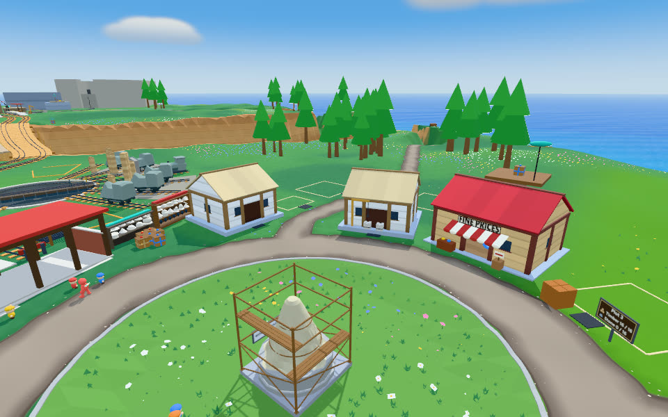
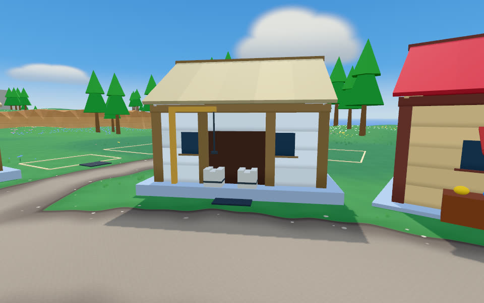

> **Status: proposal (2026-11-18).** The designer's review of the first town, Home's Round, as a lesson. Nothing
> built. Approved as a proposal job by the owner on 18 November 2026 ("The Round's second plot: start the designer's
> review of the first town as a lesson? -> Yes, as a proposal job now"). It feeds the P1 row "Home's town as the Round"
> in [backlog](../backlog.md). No copy is written here; The Boogler's lines and the residents' are untouched.

# The first town as a lesson: what the Round teaches, and its second plot

**Read for this:** DESIGN.md (core loop, 6, 7, 11), the rewards topic's Current rules and the entries
[the first town as a lesson](../decisions-rewards.md#d-2026-11-16-first-town-lesson-answers),
[the town plan's questions](../decisions-rewards.md#d-2026-11-16-town-questions-as-recommended),
[the town economy](../decisions-rewards.md#d-2026-11-12-town-economy-answered) and
[the first island teaches](../decisions-core-loop.md#d-2026-11-16-first-island-teaches);
[town-choice](../plans/town-choice.md#designer-review-16-november-the-first-town-as-a-lesson) (the 16 November review),
[first-town-lesson](../plans/first-town-lesson.md), [town-layout](../plans/town-layout.md),
[home-flip](../plans/home-flip.md) (D1 to D3 on main), the as-built [Trade](../game-design/trade.md) and
[town](../game-design/place.md#the-town-you-can-go-into) sections, [direction](../direction.md), and the code the
calls depend on (`src/place/town-plan.ts`, `src/entities/town/plots.ts`, `src/sim/railway-trade-layout.ts`,
`src/sim/town-facts.ts`, `src/entities/railway/works-view.ts`).

## The short version

The second plot's **identity is already decided and built**: the owner ruled on 16 November that it is the loader
yard (no riders; its arm loads footings onto every line 2 train), and it shipped through #1975/#1977. So what the
state file called "waits for the designer's review" was already settled on that point. What is still open, and what this
review is about, is **the building the Round puts on that plot**. Today it is the same house shell as plot 1, with a
small yellow jib on its porch (stills below). The rule teaches "a works building helps the line and brings no
riders"; the building says "another house". **Recommendation: the Round's second plot is rebuilt as a works yard**
(an open-sided shed, a proper jib in the Works arm's colours, a stack of footings), same slot, same price, same rule.

## What I looked at

Two stills from the running game, `npm run look -- --rail-seed yard-built` on `e8ae03b0`, both opened and read.
Not tested on a device; no motion judged (stills only).

| Still | What it shows |
| --- | --- |
|  | From above the green toward the quarry road (cam 872, 34, 8). The first bought house (left, by the hall) and the bought loader yard (centre, bearing 160) are the same white house with a cream roof. Fine Prices on the right; the third offer's board staked beyond it with a crate. The statue under its scaffold on the green. |
|  | From the ring road at eye height (cam 887, 21.5, 31). A house: door, windows, a pitched roof. The jib is a thin yellow post and arm on the porch with a hook and two footings at the step. It reads as a house with a porch hoist. |

## Findings

**What the first plot teaches, and it works.** The first plot (the one by the hall, board "Plot 1") carries lessons
1 to 4 of the [16 November list](../plans/town-choice.md#1-the-lesson-list-ruling) in the order met: trains bring
timber home and a pile and stakes appear (8 timber); fares from little guys fill one box at the till; a gold ghost
says "you can build this now"; holding Interact spends 150 and a house falls into place in 10 s, and fares rise from
about 36 to 54 a minute at the pier stage (town-choice's measurement). Lesson 5 (the next building costs more) shows
on the second board the same moment (400 → 800). All of it is on main and shown by the world, not by a sentence
(DESIGN 11). The Round's layout helps: every board faces the green, so the second and third offers are in sight from
the first (overview still).

**F1. The second plot's building contradicts its lesson (DESIGN 11, the main finding).** Lesson 6, "a works building
helps the line and brings no riders", is the back half of the core loop ("grown towns give upgrades that extend your
reach"). The rules teach it; the building does not. The yard grows the same `town.plot-house` shell as a house
(`plots.ts`), and its jib is a 3.4 m post on the porch. Against two houses side by side, the board's "Every train"
and footing icon are the only difference, which is the "helper text because the world is unclear" DESIGN 11 warns
about. The playtest record has the same complaint about earlier towns: "couldn't tell which cargo changed what"
and "buildings should serve a purpose" ([playtests](../playtests.md), two 2 November entries). A player who buys
it learns "the second house didn't add riders", which is a puzzle, not a lesson.

**F2. Cause and payoff are about 190 m apart, which is fine, but nothing joins them.** The purchase is in the town;
the payoff is the arm at the Works, about 190 m east of the yard (straight line from `TOWN_SLOTS` and `WORKS_RACK`,
**estimate**, not walked). That distance is right: the payoff should be where the line is, and a player riding line
2 passes the Works. But the two jibs share nothing a player would see: the town's is yellow and static, the Works arm
is grey until built and painted after (`works-view.ts`). DESIGN 7 asks the payoff to be visible; it is, but only if
the player connects two unlike things in two places.

**F3. The bought house has no one in it.** Lesson 4's payoff is a number at the till and more little guys on the
platform; the house itself is a closed shell. The 11 November decision lists who moves in (a retired engine driver,
a baker, a lost-property keeper; roles only, the characters his), and a 2 November playtest note asks for "a reward
for a building existing". This is home-flip D5, held. Not this review's job, but it is the strongest alternative for
what the Round builds next (Alternative B).

**F4. Things that are right and should stay.** The order (house by the hall, then the yard, then the stone house) is
decided and teaches in the right order. The residents' "New neighbours" line does not fire on the yard: the `town`
fact counts only rider-bearing houses (`town-facts.ts`), so the 16 November suspect line is already handled. No
choice is asked of the first town ([first island teaches](../decisions-core-loop.md#d-2026-11-16-first-island-teaches)).
Grant's "errands with no real decisions" is answered by the hubs and the garage, not by this town.

**F5. For the orchestrator.** Before 18 November's decisions-page commit (#2227) the state file said the second
plot waited for this review; its identity was settled on 16 November and built. That line is gone on main; the job
row in `docs/agents/orchestrator-state.md` can point at this proposal's question 1. I did not edit the state file
(out of scope for this job).

## Recommended second plot: the loader yard, built as a yard

- **What it is.** The same plot, rule and price, with a works building instead of a house shell: an open-sided
  timber shed (posts and a flat or mono-pitch roof, no door, no windows), a jib clearly bigger than a person standing
  at the ring road side of the plot with its hook over a stack of three or four footings, and the existing board.
  Same 7.4 × 7.4 m footprint, so no spacing changes.
- **Where.** Where it is: bearing 160 on the ring, beside the quarry road's mouth (130). It is the plot the player
  sees second, and it is on the town's working side, the road out to the line's sources.
- **What joins it to the Works.** The town jib wears the Works arm's colours and changes paint with it at the same
  completion tick, so the two read as one machine. No swing echo: a town jib that moves when nothing loads in town
  would be untrue (DESIGN 11, "what's on screen is true"). Question 2 offers the echo.
- **What it costs.** For the player: unchanged, 24 timber stakes it, 400 at the room's prices before the first house
  and 800 after (`railway-trade-layout.ts`); it lands about 19 minutes after the pier in the usual order
  (town-choice, historical **estimate**). To build: one sitting, view only as far as I read: a new construction recipe
  and prefab for the shed in `src/prefab/builders` and `src/entities/town/plots.ts`, keyed on the plot's existing
  `gives: 'loader'`; no rule, wire, save or `WORLD_NS` change. The construction beat (frame, walls, roof over 10 s)
  needs its own recipe because the house's is reused today; the builder confirms the collider hulls and the ghost.
- **What it teaches.** Lesson 6 by sight: two buildings on the green, one with people's windows and one with a
  crane, and the crane's twin at the Works is the one that changed colour. The player reaches the next hub knowing
  that a town has two kinds of building, which is what the hubs' choices will ask
  ([town-choice, section 4](../plans/town-choice.md#4-where-the-choices-go)).
- **Proof once built.** One eye-height still from the ring road with the first house and the yard in frame, both
  built (`--rail-seed yard-built`), and one still of the Works arm painted; read, not scored.

## Alternatives

- **A. Dress the house shell, keep it.** A bigger jib, footings stacked by the door, the footing icon on the door
  mat. Cheapest (no construction recipe), but the building still has a house's door, windows and roof, so F1 stays
  half-fixed.
- **B. The first house's resident first.** Put the retired engine driver (11 November's role, character and lines
  the owner's) into the first bought house before the yard, as a start on home-flip D5. It makes lesson 4 a person,
  answers the "reward for a building existing" note, and is what the playtests asked for most. It does not touch F1.
  If the owner prefers it, it goes next and the yard follows; the two do not conflict.

## Design review (2026-11-18)

Run on this proposal by its author. Reread from the top before listing.

| # | Call | Kind | Source or recommendation |
| --- | --- | --- | --- |
| 1 | The second plot is the loader yard: no riders, loads every line 2 train, 24 timber, base 400 | Decided | [16 November](../decisions-rewards.md#d-2026-11-16-first-town-lesson-answers) |
| 2 | Offer order: by the hall, then the yard, then the stone house; no choice asked | Decided | [RW-040](../decisions-rewards.md#d-2026-11-16-eight-plots-staked-by-deliveries), [first island teaches](../decisions-core-loop.md#d-2026-11-16-first-island-teaches) |
| 3 | The yard's building is a works shed with a jib and footings, not a house shell | New | Recommend yes: F1, DESIGN 11 |
| 4 | Same slot (bearing 160) and footprint (7.4 × 7.4 m) | Default | No spacing change; the blockout's walk is unchanged |
| 5 | The town jib shares the Works arm's paint and paint change | Default | F2; cheap to drop |
| 6 | No swing echo in town | Default | DESIGN 11, "what's on screen is true" |
| 7 | No resident, interior or Talk at the yard | Default | Nobody lives at a works; the `town` fact already skips it |
| 8 | The yard builds up over the same 10 s beat as a house | Default | `TRADE.buildTicks` unchanged |
| 9 | Board strings "Every train", "Plot 2" stay placeholders | Default | Already listed for the owner in [Trade](../game-design/trade.md#copy-and-evidence) |
| 10 | Next after the yard: the first house's resident (Alternative B) | New | Recommend the yard first, the resident right after |

**Level design.** The space is unchanged by the recommendation (same slot and footprint). Flow from the stills: the
board faces the green and is in sight from the first house and the till's side of the ring; walking from the hall to
the yard's board is about 40 m round the ring, about 7 s at 5.6 m/s (**estimate** from the slot radii, not walked).
Rule 1 (the next goal can be found) holds: the gold ghost and board say it. Rule 2 and 3 are untouched: nothing on
the main route needs this purchase. Not seen: the Works arm's painted state in a still, a two-player view, phone width.

**Missed as design, checked.** First meeting: the staked board at 24 timber, then the ghost when the box can pay.
Learning without being told: the shed's shape and the two jibs (this proposal). Co-op: anyone may buy; one shared
box; a friend sees the same building go up. Solo: unchanged. Late arrival: the yard stands, nothing to explain.

**Owner questions** (each proceeds on its recommendation; nothing waits)

1. **The Round's second plot becomes a works yard to look at (an open shed, a jib, a stack of footings) instead of
   the house shell it grows today, with the same slot, price and rule?** Recommended: **yes.** Or dress the house
   shell (Alternative A).
2. **The town's jib wears the Works arm's colours and repaints with it, and does not swing?** Recommended: **yes.**
   Or it also swings each time the Works arm loads a train (a local echo of the same loading edges).
3. **After the yard, the first bought house gets its resident (the retired engine driver; who it is and every line
   are yours)?** Recommended: **yes, right after the yard.** Or the resident first.
4. **Keep the yard at bearing 160, beside the quarry road?** Recommended: **yes.** Or the free 100° slot nearest the
   line, which moves a plot row (spacing and the tree table unmeasured).

Calls 3 to 10 are logged in [agent-calls](../agent-calls.md) (rewards, open).
