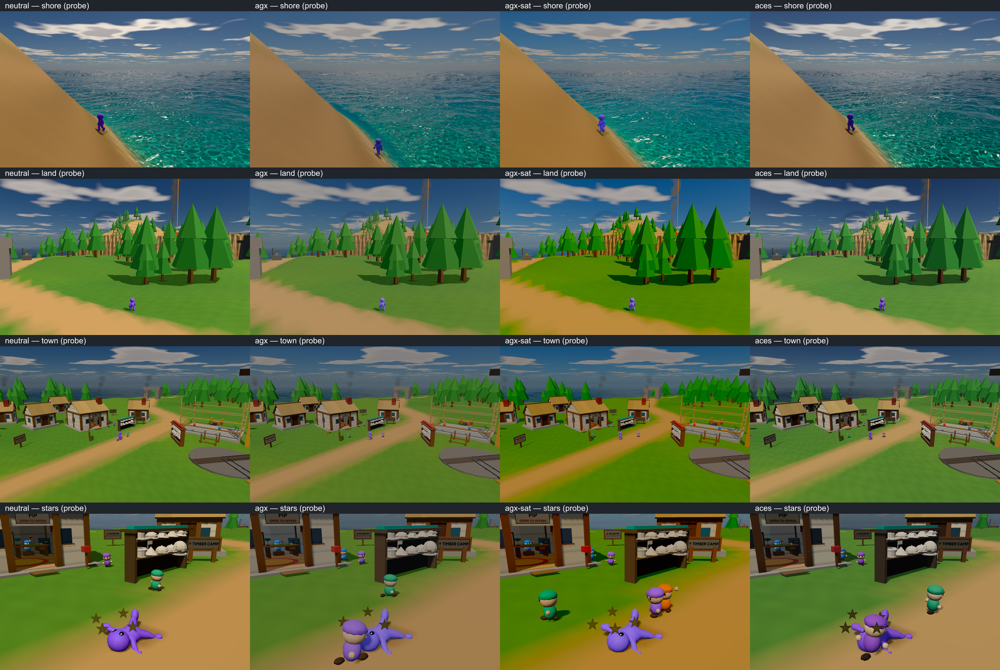
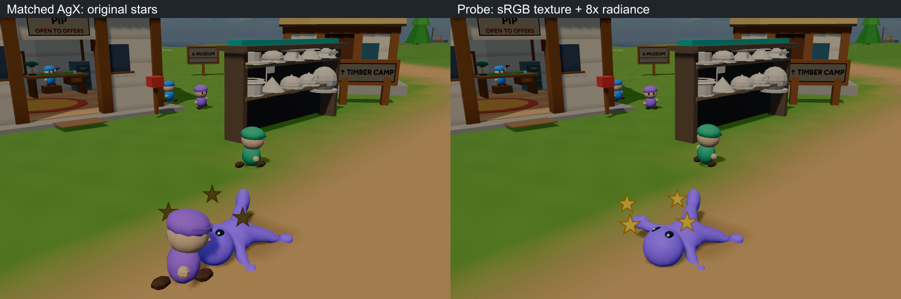

# Colour and post: a sunny toy world

> **Verdict:** Calibrate one sunny look under AgX; replaced by metered Neutral and fixed exposure.
> **Top recommendations:** 1. Calibrate one outdoor look. 2. Repair material intent before post. 3. Use one output owner: linear HDR scene → underwater/fog composite → exposure/white balance → HDR bloom → AgX → gentle.
> **Status:** superseded by [color-sources](color-sources.md); see [Look](../decisions.md#look).

3 November 2026. Research recommendation, **not an approved renderer change**. Serves DESIGN.md **Show, don't tell**, **Telegraph everything**, and **Small and readable**.

**Keep the frozen late-morning demo sky and water AgX; fix radiance/exposure and the material palette, then add a restrained grade and bloom.** A more saturated curve alone does not make this world sunny. Keep honey timber, warm cream/tan land, cyan shallows and blue distance; reserve stronger reds/purples/yellows for toys and feedback. Preserve the Buddy's Castle Story **Bricktrons-like proportions and soft shoulders, without rim light**, as the [owner decided](../decisions.md#characters-and-story).

## Recommendations, in order

1. **Calibrate one outdoor look.** Keep `tod=0.24`. Start from production AgX, expose for the player, grass and cream wall, and record a fixed outdoor reference exposure. Later bound adaptive exposure tightly around it, using subject-weighted or percentile metering; retain a deliberate cave transition. Do not let looking up at bright sky make feedback muddy. Establish white balance before selecting saturation.
2. **Repair material intent before post.** Give unlit feedback an explicit HDR brightness budget; the knockdown stars are the concrete first repair below. Tune foliage shade and sun-to-fill balance together; keep broad, clean material groups and modest baked contact shading. Do not brighten all albedos or add emission to all foliage. Retain Buddy's existing small fill; no new rim.
3. **Use one output owner:** linear HDR scene → underwater/fog composite → exposure/white balance → HDR bloom → AgX → gentle display-linear grade → sRGB encoding → tiny output dither. Meter before bloom; agree exposed-HDR threshold units with the bloom job. Start with uniforms; bake the accepted fixed grade into one small 3D LUT only when it earns that complexity. Do not stack the look lab's encoded-space grade on top.
4. **Compare just three looks in the dev tool:** production AgX control; **AgX “sunny toys”** with calibrated feedback/fill and a highlight-protected chroma lift (recommended); metered Neutral as the palette-preservation challenger. `agx-sat` is a useful starting lever, not an accepted final grade. ACES is a diagnostic fourth column, not another proposed direction. One question: **Which keeps the toys inviting and the sea luminous?**
5. **Integrate through the existing jobs, then stop for the owner.** `water-bloom` owns bloom; supply emissive/glint test cases and the common exposure convention, not another bloom implementation. `src/debug/water-tuning.ts` already owns exposure, auto-exposure, key, contrast and saturation controls. The grade-preview dev-tool research should add saved/reversible looks, fixed cameras, exposure lock and a reference ramp around those bindings and the active water post owner. No second panel, renderer, meter or general volume system. Measure the final combined path before graduating it.

**Budget, proposed rather than measured:** M1 Max at 2560×1440, 60 Hz, total GPU p95 ≤10 ms within a 16.7 ms frame; allocate ≤1 ms incremental grading/meter/bloom work, including ≤0.6 ms bloom. Keep cheap grade/dither in the output draw. iPad scales scene resolution and bloom size first; target ≤0.5 ms added post at its chosen render resolution, with bloom optional. Preserve MSAA and the existing resolution owner. No current isolated timing or device test was performed; screenshot frame counts are not GPU benchmarks.

## What the game actually shows



Columns: **Neutral / water AgX / AgX-sat / Three ACES Filmic**. Rows: shore, trees/props, town, player/stars. These are **temporary comparison probes**, not four working production presets. Same camera per row, 960×600, real-time 15 s metering warm-up, `proto=place&water=new&sky=demo`. The eval recolours the player purple and holds the actual knockdown effect for 120 s; this does not validate collision triggering. Water, residents and star phases advance independently; the shoreline avatar can slide. No offline colour correction.

**Critical flag trap:** [tone-compare.ts](../../src/features/tone-compare.ts) explicitly disables `tone=` under `water=new`; [water/post.ts](../../src/render/water/post.ts) always selects AgX. `sky=demo` is also bypassed there because the production sky already bakes the demo atmosphere. Four unmodified URLs would not compare curves. The reverted probe substituted the existing comparison recipes at that one output point, preserving the HDR input, meter and sRGB encoding. Constant grey-match trims: Neutral **1**, AgX/AgX-sat **0.771116**, ACES **0.729587**; production AgX has no such trim. Thus the board's AgX is about **−0.375 EV** relative to production, not an exact production screenshot.

**Plain verdict:** Neutral is the most immediately lively control: stronger greens, warmer paths and a more saturated purple player. AgX is gentler but muted. AgX-sat makes the grass too yellow/green and the town too uniformly saturated; **reject its full 30% lift as the final grade**. ACES gives a cooler, harder sky/cream-wall balance and deep shade, without solving star readability. All four leave dark tree faces and brownish stars. Start the recommended AgX grade with only **5–12% midtone chroma lift**, then judge foliage separately. The proposed finished look remains unverified.

### Why the stars are dark

[impact.ts](../../src/features/impact.ts#L267) draws **four 0.3 m sprites**, using a 64² canvas: fill `#ffd84a`, 3 px border `#b37a00`; `SpriteMaterial`, transparent, depth-write off, default white colour/opacity 1. **No emissive property and no lighting response.** The texture has default `NoColorSpace`, not sRGB. The HDR scene is subsequently multiplied by the scene meter and tone-mapped: these nominal 0–1 unlit pixels compete with the much brighter sun/environment-lit scene. `toneMapped=false` on a sprite would not bypass the final full-scene transform.

The missing sRGB tag is a separate correctness problem: it treats encoded `(1,.847,.290)` as linear instead of approximately `(1,.687,.068)`. That makes the raw sprite **brighter and less yellow**, not darker; tagging it alone cannot fix the darkness. Calibrate radiance after correcting it. The probe below tags it sRGB and multiplies the sprite colour by **8** in linear HDR (a brightness test, not a final tuned value). This is the sprite equivalent of raising emission; adding a point light or increasing hemisphere fill would do nothing to an unlit sprite.



The 8× probe changes the stars from muddy olive-brown to clearly readable gold; it does not add bloom or change the terrain. This supports repairing their radiance, not replacing the entire curve to fix them. Tune the final brightness against both sunlit ground and dark surroundings; 8× is not yet a shipping prescription.

<details>
<summary>Pipeline reference: curves, LUTs, exposure, gamut and HDR</summary>

## Pipeline choices, without mystique

Scene-referred colour represents light before display rendering: decode colour textures to linear, shade, composite, expose (`2^EV`) and white-balance there. Display-referred grading works on the already compressed image: useful for palette/split-tone polish, but cannot recover clipped highlights. “Linear” and “scene-referred” are not synonyms: the AgX output here is **display-linear** before sRGB encoding. Keep HUD outside the scene grade.

| Curve                   | Useful property and trade-off                                                                                                                                                                        | Boogle decision                                                                                                                                                                         |
| ----------------------- | ---------------------------------------------------------------------------------------------------------------------------------------------------------------------------------------------------- | --------------------------------------------------------------------------------------------------------------------------------------------------------------------------------------- |
| **AgX / Punchy**        | Broad exposure handling and progressive highlight desaturation; strong colours lose chroma toward white. Punchy is a look applied with a defined transform/domain, not simply any saturation slider. | Keep the existing water version. It already adds power **1.12**, saturation **1.3** inside its AgX graph; it is neither stock Three AgX nor a verified canonical Punchy implementation. |
| **Khronos PBR Neutral** | Preserves base-colour relationships through much of the range; still compresses/desaturates highlights. Installed implementation starts shoulder compression at post-offset peak **0.76**.           | Best challenger. Already Three's Neutral; do not add a duplicate.                                                                                                                       |
| **ACES**                | Attractive contrast/shoulder, but legacy fits can skew saturated hues (notably blue toward purple) and clip after gamut conversion.                                                                  | Current `ACESFilmic` is a fitted RRT/ODT-style transform, **not all of ACES or ACES 2**. Check purple/blue and bright yellow, not only grey ramps.                                      |
| **Gran Turismo GT7**    | Exact current GT7 transform was unavailable locally. The widely circulated **Uchimura/GT 2017** toe/linear/shoulder curve is not evidence of GT7's current pipeline.                                 | Research lead, not a justified replacement or tested preset.                                                                                                                            |
| **Tony McMapface**      | LUT-based display transform; its colour-volume mapping is the attraction, with a texture lookup rather than just a channel curve.                                                                    | Worth a later controlled comparison if AgX fails; original LUT/domain must be verified first.                                                                                           |
| **Hable / Uncharted 2** | Adjustable filmic toe and shoulder/white point; requires exposure calibration, with possible chroma changes in per-channel use.                                                                      | Mature, but no demonstrated advantage for this palette.                                                                                                                                 |
| **Reinhard**            | Cheap `x/(1+x)` baseline; simple version has a long compressed tail and no finite white point. Per-channel application changes colour ratios.                                                        | Debug/reference, not the target look.                                                                                                                                                   |
| **Lottes**              | Parameterized HDR compression with a tractable analytic fit; implementation and colour handling matter.                                                                                              | Another useful reference, no reason to add it before the current look is calibrated.                                                                                                    |

**Evidence:** AgX, Neutral, ACES and Reinhard above were inspected in installed Three r187 `src/nodes/display/ToneMappingFunctions.js`, alongside Boogle's graph. Hable/Lottes/Tony/GT7 are technical orientation and unverified external leads, not newly tested implementations. Bright-colour hue skews are not solved by a grey curve alone: inspect RGB/CMY sweeps and a sunlit toy at multiple exposures. Saturating already clipped RGB can push it out of gamut again; taper chroma in highlights and prefer smooth gamut compression over a hard clamp when the extra complexity proves useful.

**LUT authoring/cost.** Author a grade with a known identity cube and colour chart in the **exact input domain**, export `.cube`, verify channel order, domain and neutral ramp, then compare live versus baked on all four views. A 33³ RGBA16F cube is **287,496 bytes (~281 KiB)**. Installed `Lut3DNode` uses one 3D texture sample with half-texel edge coordinates: hardware trilinear filtering blends eight texels, not “eight extra full-screen passes.” It can fold into the existing output draw. A LUT bakes colour-only transforms, not spatial fog, bloom, auto-exposure or material relighting; an SDR display-grade LUT is not an HDR-display transform. Store LUT data without accidental sRGB texture decoding. Keep exposure outside a bounded SDR cube to avoid clipping its domain.

**Exposure/white balance.** The current log-average meter has 32²×16 HDR taps, a 16² reduction and a history texel; exposure clamps **0.05–20**, darkens at **2.5/s**, brightens at **1/s**. It meters the whole scene, not a protected character region. Auto-exposure can cancel a global light increase; change the sun/fill _ratio_ and lock exposure while judging it. White balance is a chromatic adaptation before the curve; avoid using a global orange grade to disguise mismatched sun, sky and fog.

**sRGB, gamut, HDR, dither.** Boogle explicitly outputs SDR sRGB. Rec.2020 intermediate matrices inside AgX do not turn the canvas into wide-gamut/HDR output. Installed WebGPUBackend supports `outputType: HalfFloatType` → `rgba16float` and canvas `toneMapping.mode='extended'`; it does not pass a P3 canvas `colorSpace` in its configure call. WebGPU's canvas configuration has wide-gamut/HDR mechanisms, but browser/display support and end-to-end colour management need fresh verification. AgX's current 0–1 clamp, hand-written sRGB output, screenshots and HUD would all need deliberate treatment. Keep SDR as the target now. Add about one code value of zero-mean dither **after encoding, before 8-bit quantization** to reduce sky/fog banding; it cannot fix clipped gradients. The retained water demo has dither/vignette, but the production water post currently has neither. Check shimmer and actual ramps before choosing temporal versus static noise.

</details>

## Look beyond post

| Inspected source                                                                                                                         | Actual finding → useful next action                                                                                                                                                                                                                                                                                                            |
| ---------------------------------------------------------------------------------------------------------------------------------------- | ---------------------------------------------------------------------------------------------------------------------------------------------------------------------------------------------------------------------------------------------------------------------------------------------------------------------------------------------- |
| [scene.ts](../../src/render/scene.ts), [frozen-sky.ts](../../src/render/water/frozen-sky.ts)                                             | Legacy Neutral/exposure 1 and sun 2.5/hemi 1.2 are **not** the effective new-water look. Frozen sky uses cube-derived sun colour, sun intensity `π × sunColor.r`, hemisphere intensity `π` with sampled upper/lower radiance, and the cube environment. Tune this owner; changing legacy constants may be overwritten.                         |
| [place/look.ts](../../src/proto/place/look.ts), [land.ts](../../src/proto/place/land.ts)                                                 | Standard-node terrain roughness **.95**, grass `#6c9a42`/`#568740`, pine tiers `#3f8a3a`/`#4f9c44`; procedural warm/dry multipliers and contact darkening already exist. Pine linear luminance is ~**.195/.259**, grass ~**.267**: not intrinsically black albedo. The shade/fill/grade relationship and simple cone geometry need work.       |
| Same material helpers                                                                                                                    | Warm rock `#d0a872` has linear Y~**.426**, honey wood `#a56a2c` ~**.185**, cream `#efe0ba` ~**.752**. Wood roughness mostly **.85–.9**, toy accents **.55–.7**, steel **.7 metalness/.45 roughness**. Some steel adds a fake sky emissive term; retest it alongside the real environment to avoid double emphasis.                             |
| [avatars.ts](../../src/player/avatars.ts), [buddy/body.ts](../../src/player/buddy/body.ts)                                               | Avatar fill is base-colour emission at **.15**; Buddy clones its asset's `M_Main` then uses `paintAvatar`. The generic avatar's **.55** roughness is not proof of the imported Buddy's roughness. Keep this distinction when tuning.                                                                                                           |
| [look-post.ts](../../src/debug/look-post.ts), [look-world.ts](../../src/debug/look-world.ts), [look-lab.ts](../../src/debug/look-lab.ts) | Lab grade follows `renderOutput` (already encoded); its warm/cool grade and edge fade include reversed-edge smoothsteps, contrary to the current TSL contract. Do not copy the graph blindly. Its presets also own an alternate pass/fog/material setup: `look=high` on place is not an invitation to stack the whole lab on production water. |

As a **heuristic**, ordinary nonmetal diffuse reflectance mostly lives around **.02–.8 linear**, with measured materials varying and saturated pigments judged per colour, not by forcing every channel above .02. These Boogle swatches largely fit; bright toy colours can intentionally depart. Measure the shader's final albedo, including vertex colour, grain and contact multiplication, before blaming a hex swatch. Keep emission separate from albedo. AgX goes dull when wide luminance/chroma ranges enter its shoulder, when exposure puts toys too low, or when the palette/fill lacks separation; it cannot supply missing art direction.

Use a warm key, cool but readable open shade, sky-coloured distance, and a limited family of leaf greens. The production sky already supplies directional fog; preserve that relationship and add only gentle height density if needed. Read Lambert and Standard surfaces separately: the hemisphere exists to support Lambert toys, while Standard also receives the environment. Global fill boosts can flatten faceting and wash the water. The inspected `boogle-water/shot-2.png` and `crossing-beauty/shot-2.png` in the main checkout set a useful target: warm solids, luminous cool water, clear silhouettes and restrained detail. They are generated previz, not measured material swatches or renderer evidence.

<details>
<summary>Post-effect decisions and the older measurements to retest</summary>

## Post effects: value versus cost

Costs describe typical work, not new millisecond measurements. “Fused” means ALU/samples in an existing draw; “passes” includes render-target bandwidth.

| Effect                | What it gives / usual cost                                                                         | Decision here                                                                           |
| --------------------- | -------------------------------------------------------------------------------------------------- | --------------------------------------------------------------------------------------- |
| Bloom                 | Luminous glints/emission; threshold plus down/up-sampling passes, fill/bandwidth cost.             | Restrained reduced-resolution bloom, coordinated with `water-bloom`; not a global veil. |
| Ambient occlusion     | Grounded creases; baked vertex AO is cheap, screen AO needs depth/normals plus sampling/filtering. | Existing contact shading first; GTAO off by default.                                    |
| Volumetric god rays   | Real light shafts; ray-march/froxel integration and often temporal filtering.                      | Defer.                                                                                  |
| Fake god rays         | Authored shaft/cone cards or screen radial blur; cards cost blended overdraw, blur costs passes.   | Local special moments only; test occlusion.                                             |
| Height / aerial fog   | Depth, scale and colour separation; analytic fog can fuse, cube/gradient lookup adds samples.      | High value: keep sky-consistent aerial fog, subtle height extension.                    |
| Vignette              | Concentrates attention; cheap fused ALU.                                                           | Off or barely perceptible; do not darken peripheral gameplay.                           |
| Colour-graded shadows | Warm/cool separation; fused math/LUT.                                                              | Gentle cool tint with a neutral anchor; fix actual fill first.                          |
| Sharpening            | Restores apparent detail after resolution reduction; neighbour taps, sometimes a pass.             | Optional mild upscale sharpening, watch halos on foam/fronds.                           |
| Chromatic aberration  | Lens imperfection; displaced RGB samples.                                                          | Off: damages toy edges/text without helping this direction.                             |
| Outlines              | Silhouette separation; depth/normal sampling or extra hull draws.                                  | Off by default; painted selective edges only if readability needs them.                 |
| Depth of field        | Focus/miniature scale; depth + multi-tap blur/composite.                                           | Photo mode only.                                                                        |
| Tilt-shift            | Diorama impression; separable blur and focus-band blend.                                           | Photo mode only; gameplay must stay readable.                                           |
| Contact shadows       | Anchoring at feet/props; blobs/baked AO cheap, screen rays/shadow-map improvements more expensive. | Keep cheap contacts; do not stack several darkening systems.                            |
| Rim light             | Silhouette/readability; cheap material ALU, no required new pass.                                  | **No on Buddy** per owner; not part of the recommended global look.                     |

**Retest [visual-target.md](../proposals/visual-target.md)** under the new sky/water/AgX: “nothing blooms,” the grade's warmth/saturation, fog stacking, AO visibility near the player, shadow coverage/softness, and all preset/device costs. Its M1 Max totals (e.g. ~1.0–1.3 ms baseline, ~1.8 ms `ipad`) predate this route and used a shared GPU; its 3× iPad multiplier was an estimate. The old “rim in any look” recommendation is superseded by the Buddy decision. DoF/tilt/black-grass-outline readability concerns still apply, independently of the curve.

</details>

<details>
<summary>Named game references: what fits Boogle</summary>

## Game references: borrow specific features

These are **design interpretations**, not claims to have reverse-engineered each renderer or identified its tone curve. **S** means an existing repo account was read; **I** means a visual reference/inference with no verified technical source in this run.

| Reference                                     | Feature that fits Boogle / boundary                                                                                                                                      | Basis                                                  |
| --------------------------------------------- | ------------------------------------------------------------------------------------------------------------------------------------------------------------------------ | ------------------------------------------------------ |
| **Breath of the Wild / Tears of the Kingdom** | Large value groups, coloured shade and atmospheric depth keep distant terrain readable; avoid blanket cel-band conversion.                                               | S/I; do not transfer a BotW breakdown to TotK as fact. |
| **Mario Odyssey / Wonder**                    | Odyssey's warm coastal solids against blue water; Wonder's bold local colour hierarchy and readable characters. Borrow palette discipline, not a presumed shared shader. | Odyssey S; Wonder I.                                   |
| **Animal Crossing**                           | Soft toy forms, gentle material response and welcoming shade; no gameplay blur.                                                                                          | S, secondary tech-analysis account.                    |
| **Sable**                                     | Biome colour grouping and distance fog preserve readability; its ink treatment is not our target.                                                                        | S, developer-interview account.                        |
| **Journey**                                   | A coherent warm/cool scene and one excellent dominant material; apply that attention to Boogle's water/shore.                                                            | S, GDC talk via secondary account.                     |
| **Tunic**                                     | Rounded matte forms and layered material detail; keep simple surfaces before adding AO/noise.                                                                            | S, interview/secondary accounts.                       |
| **A Short Hike**                              | Summer palette and deliberately modest detail; retain Boogle's clean resolution.                                                                                         | S, developer's article.                                |
| **Sea of Thieves**                            | Separate water body colour, reflection, crest lighting and foam; already the right vocabulary for this sea.                                                              | S, SIGGRAPH paper account.                             |
| **Fortnite / Genshin**                        | Distinct character/landscape value groups; Genshin's attractive coloured shade. Avoid equating that result with “turn on ACES” or importing anime face shading.          | I; exact rendering pipeline unverified.                |
| **Astroneer**                                 | Broad coloured shapes, few material families, visual equipment feedback.                                                                                                 | S, System Era interview account.                       |
| **Valheim**                                   | Atmosphere makes simple geometry feel rich; retain clearer, lighter play spaces here.                                                                                    | S, secondary accounts.                                 |
| **Firewatch**                                 | Distance-layer colour and composed silhouettes; useful for long crossings without detailed surfaces everywhere.                                                          | S, GDC recap/reimplementation.                         |
| **Grounded**                                  | Strong scale cues, foliage backlighting and warm sunlight; do not inherit its dense surface detail or post budget.                                                       | I; technical source unverified.                        |

</details>

## Sources, limits and reproduction

**Read firsthand:** the linked Boogle code/docs, [render/tone.ts](../../src/render/tone.ts), [proto/tone.ts](../../src/proto/tone.ts), installed Three r187 tone/LUT/WebGPU output implementations, the two named previz PNGs and water-board notes, and the capture images listed below. **Read as secondary research:** [Looks that are mostly code](bang-for-buck-aesthetics.md), [Sunshine look](sunshine-look.md), [Stylized rendering](stylized-rendering-on-a-budget.md), [Art-kit pipeline](art-kit-pipeline.md#astroneer-simplify-the-art-process-while-retaining-physical-information), [Tone comparison](tone-comparison.md), [Sky comparison](sky-comparison.md). Their “verified” badges describe their authors' earlier reads, **not a fresh verification here**. External networking was prohibited; no external page, paper or talk was opened in this job.

Real source trail, with status explicit:

- **Local implementation read; upstream not opened:** [Three tone functions](https://github.com/mrdoob/three.js/blob/r187/src/nodes/display/ToneMappingFunctions.js), [Khronos PBR Neutral](https://github.com/KhronosGroup/ToneMapping/blob/main/PBR_Neutral/README.md), [AgX configuration](https://github.com/sobotka/AgX). These are the appropriate checks before claiming a canonical look match.
- **Secondary accounts read; originals not opened:** [Sable developer interview](https://www.gamedeveloper.com/marketing/how-shedworks-refined-the-art-of-sable-in-pursuit-of-readability), [A Short Hike developer article](https://blog.playstation.com/2021/08/05/crafting-a-tiny-open-world-a-look-behind-the-scenes-at-the-creation-of-a-short-hike/), [Sea of Thieves SIGGRAPH paper](https://history.siggraph.org/wp-content/uploads/2022/09/2018-Talks-Ang_The-Technical-Art-of-Sea-of-Thieves.pdf), [Astroneer developer interview](https://www.unrealengine.com/developer-interviews/inspired-space-inside-the-development-of-astroneer).
- **GDC/tech-art leads, not watched:** [John Edwards, Sand Rendering in Journey](https://gdcvault.com/play/1017742/Sand-Rendering-in), [Jane Ng, The Art of Firewatch](https://gdcvault.com/play/1022295/The-Art-of), [3D Toon Rendering in Hi-Fi Rush](https://gdcvault.com/play/1034251/3D-Toon-Rendering-in-Hi). Hi-Fi Rush's authored shadow colour is relevant; its custom deferred pipeline is not a small post effect.
- **Unopened algorithm leads:** [Tony McMapface](https://github.com/h3r2tic/tony-mc-mapface), [Hable's filmic article](http://filmicworlds.com/blog/filmic-tonemapping-operators/), [Reinhard paper](https://www.cs.utah.edu/docs/techreports/2002/pdf/UUCS-02-001.pdf). GT7 and Lottes need their original technical material before implementation; no claim of source verification.
- **Engine comparison, docs not freshly verified:** [Unity URP colour adjustments](https://docs.unity3d.com/Packages/com.unity.render-pipelines.universal@17.0/manual/Post-Processing-Color-Adjustments.html), [Unreal colour grading and filmic tonemapping](https://dev.epicgames.com/documentation/en-us/unreal-engine/color-grading-and-the-filmic-tonemapper-in-unreal-engine), [Godot environment/post](https://docs.godotengine.org/en/stable/tutorials/3d/environment_and_post_processing.html). Their established pattern separates scene lighting/exposure, tone mapping and artist grading. Boogle should keep that separation inside its existing output graph; it does not need their full post-volume infrastructure. [WebGPU canvas configuration](https://www.w3.org/TR/webgpu/#dictdef-gpucanvasconfiguration) is the unverified specification lead for P3/HDR support, not proof on the owner's devices.

**Capture provenance.** Base commit `9d0e33ce`, clean source tree `9dceed46`; the 16-panel probe tree was `a5797805`. Every comparison manifest reports unchanged source during its run and capture-health success. [Board index / all 16 manifests](../../.look/evidence/1793774615775-75122/color-board-manifest.json), [star probe](../../.look/evidence/1793774615775-75122/evidence.json), [original production baseline](../../.look/evidence/1793773951548-53853/evidence.json), [restored production capture](../../.look/evidence/1793774655238-76693/evidence.json). Opened: both assembled boards (all 16 panels), individual AgX/Neutral shore/land, original and restored stars, the raised-star still, both bot end stills, and the two previz shot-2 PNGs. JPEG boards only resize/label captures; native PNGs remain beside the manifests.

[Reproduction eval](../../.look/evidence/1793774615775-75122/color-setup.ts) and [temporary patch](../../.look/evidence/1793774615775-75122/color-probe.patch) are archived with that probe, **not committed game code**. Apply the patch only in a disposable local probe, then use the broker:

```sh
node .look/see-client.ts look --query 'proto=place&water=new&sky=demo&tone=agx&colorShot=shore' --eval .look/color-setup.ts --real --warm 15 --frames 2 --seconds 0.2
```

Repeat `colorShot=shore|land|town|stars` and `tone=neutral|agx|agx-sat|aces`; `starProbe=1` adds the isolated radiance test. Restore the patch afterwards. Without it, those tone flags remain inactive on new water.

**Bot and limits.** The [correctly invoked playthrough](../../.look/evidence/1793774653919-76315/evidence.json) reached seven stretches, the forge, double jump, hook and glide, then stalled after 24 simulated minutes; trains and later town/shop beats remain unverified. Its report and end still were read; no page/graphics errors. Earlier attempts omitted `proto=place`, then `shot=play` (setup failures, not evidence of a game defect); the first star probe used an unresolved bare browser import and was corrected. No gameplay fixes were attempted. Local refs were inspected instead of `npm run inflight`, which fetches remotely. No network research, HDR-display validation, isolated GPU benchmark or real-time motion verdict. **Not tested on a device.**
