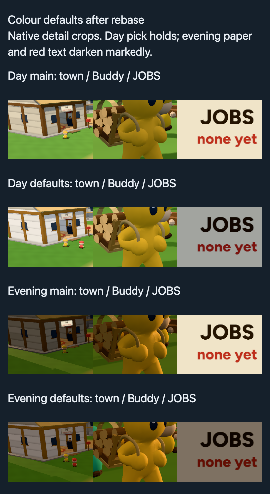

# Owner colour defaults — remote-name follow-up, 5 November 2026

**Remote names now use full readable-unlit compensation once. Six new three-way boards show clear white lettering without looking garish or too bright, including evening. Rebased onto `origin/main` at `8270d364`, retaining both sides.** The earlier evening lit-board concern remains: paper/red ink is too dim for unqualified distance/phone clearance. Research evidence is **8.28 MB**, only reader-facing boards and small JSON. Raw scenes, scripts and logs remain under `.look`; heavy files are absent from branch history. No push, ship or merge.

## Remote-name follow-up

The coordinating session approved this additional fix. `avatars.makeLabel` now wraps `SpriteNodeMaterial` in `readableUnlit`, exactly like station labels. The helper compensates **both letters and backing RGB**, retaining the sRGB canvas and alpha. Assertions on the actual remote material confirmed the identical color node after two further helper calls, transparent=true, depthWrite=false, fog=true, opacity=1 and sRGB map. Read-only review confirmed the unchanged map/opacity path and downstream underwater composite; every effective readback retains +.81 EV. Classic gain 1 is neutral. No identity/presence, geometry, copy, sky or water code changed. Deep-submerged name legibility was not established by the waterline view.

Visual question: **can a real remote name be read at play distance without glaring against sky, ground, water or evening?** Two browser profiles exchange **Grant** through normal presence; the actual remote entity makes its label. The fixture positions each peer through its own physics teleport, with no substitute label/fake remote. Baselines are clean main `10dc567b` at .16 and clean branch `08a2056a` at .12; after is clean `92fb3301` at .12. Rebases rewrote the final runtime to `86736227`, with **no runtime-file differences**. Main advanced through `193de1c8` and `63f26a10` to `8270d364` while this report was finishing; all changes since `82f8381e` are documentation, plans, skills and reference images. No gameplay, player or Place code arrived in this rebase, so the conditional long-bot rerun was **not triggered**.

All six boards were opened. Each is one native-pixel column, cropped from 800×500 DPR-1 scenes at (160,130,480,360); all **18 cells match their source pixels exactly**. Full scenes and reproducible setup/capture/measurement scripts remain in [`.look/color-defaults/names`](../../.look/color-defaults/names). Cameras match; swimming bob, waves and moving residents differ. Phone-width layout is not a mobile device test.

| Opened board | Main .16 RGB / contrast | Before .12 RGB / contrast | After .12 RGB / contrast |
| --- | --- | --- | --- |
| [Town, play distance, sky](color-defaults/names-play-sky.png) | 91,92,94 / 1.79 | 74,75,77 / 1.57 | 233,234,235 / 10.68 |
| [Town, close, sky](color-defaults/names-close-sky.png) | 97,97,97 / 2.06 | 80,80,80 / 1.83 | 240,240,240 / 12.07 |
| [Town, play distance, ground](color-defaults/names-play-ground.png) | 102,96,91 / 1.37 | 90,83,76 / 1.84 | 234,232,231 / 3.30 |
| [Town, close, ground](color-defaults/names-close-ground.png) | 97,97,97 / 1.34 | 80,80,80 / 1.92 | 240,239,239 / 3.58 |
| [Waterline](color-defaults/names-waterline.png) | 97,97,97 / 1.20 | 80,80,80 / 1.14 | 240,240,240 / 6.20 |
| [Evening, play distance](color-defaults/names-evening.png) | 91,92,93 / 2.07 | 74,75,76 / 1.77 | 233,234,235 / 12.03 |

RGB is mean sampled letter RGB; contrast uses linear-sRGB luminances plus .05 against adjacent translucent backing. Town/evening share a fixed after-image letter mask; waterline uses separate core masks for bob/raster phase. Anti-aliasing mixes background into small letters, notably over ground. [Exact masks, samples, cameras, properties, gains, loads and manifests](color-defaults/names-measurements.json). These are diagnostic ratios, not accessibility certification.

**Observed:** old grey letters are weak at play distance and waterline. Compensation makes Grant immediately distinguishable, with crisp close-up white, soft edges and subdued backing. Small ground-backed labels remain less conspicuous than sky-backed labels, but read clearly. Evening names look like readable labels, not glowing scene lights. **They do not look garish or too bright in these images.** No fixed-scale fallback or other tuning was applied. The earlier evening physical-board concern remains separate and open.

Fresh manifests: [main day](../../.look/evidence/1793907241032-56870/evidence.json), [main evening](../../.look/evidence/1793907311645-58564/evidence.json), [main waterline](../../.look/evidence/1793907387094-59356/evidence.json); [before day](../../.look/evidence/1793907084288-52930/evidence.json), [before evening](../../.look/evidence/1793907172172-54941/evidence.json), [before waterline](../../.look/evidence/1793907452868-59693/evidence.json); [after day/waterline](../../.look/evidence/1793907503678-59920/evidence.json), [after evening](../../.look/evidence/1793907574015-60359/evidence.json), [native boards](../../.look/evidence/1793907753631-63393/evidence.json). All have status 0, `changedDuringRun: false` and no graphics/page errors. Scene captures passed exact frozen-repeat checks. Earlier framing attempts are retained in the JSON index.

One [initial 5× two-peer run](../../.look/evidence/1793906877630-51583/evidence.json) failed its clock-deficit check before capture: peak deficits 2.44/2.03 game seconds, despite equal world ticks. The 1× retry succeeded. Start load was 32.14/27.50/25.70 on 10 cores; selected capture start one-minute averages ranged from 30.67 to 79.52. Stalls, rates and GPU cost remain **unproven under contention**. This is a capture warm-up failure, not a long-bot missed beat or demonstrated gameplay regression.

Post-rebase **world-inputs passed all seven assertions**, with no graphics errors: [manifest](../../.look/evidence/1793908372508-88570/evidence.json). Broker fixture/home-land hashes match this worktree. **Node 26.13.0 `npm run check` passed** lint, types, all 330 tests, registry, assets, level checks and build: [final log](../../.look/color-defaults/names/check.txt), [uptime](../../.look/color-defaults/names/check-load.txt). Prettier ran on the changed files, respecting the repository's Markdown/research exclusions. The previous long bot/first-slab success below is historical, not rerun or claimed fresh. Other unlit materials were not edited; station/reward checks below remain historical coverage.

## Earlier rebase and exact scope

The earlier implementation/helper commits below are now `893ebf60`/`7d54cd4e` on `8270d364`. This latest rebase added only main's documentation changes; the original lighting port remains intact.

Runtime commit `a2c28507` and capture helpers `0f365a63` sit on main `82f8381e`. The rebase kept both sides of the frozen-sky and decision-index conflicts. `frozen-sky.ts` retains main's `readFill`, `prepare`, prepared environment selection, fade lifecycle and loading-time `cubeSize` handling. Only the existing scene-light owner/defaults and multiplier application differ. `sky-core.ts`, `evening-transition.ts` and `water-render.ts` are byte-identical to this main. A separate read-only review found no integration issue. The current evening design paragraph now describes .12 and the chosen lights; historical .16 verification remains labelled historical.

The owner pick remains **surface .12; underwater +.81 EV; key 1.12; fill 3.2; grass pigment .35/albedo .7; selective colour; lit physical boards and shop price atlas**. The lighting gains apply after the prepared sky's fill/radiance selection, to both endpoints. No evening parameters or sky-size behaviour were retuned. Evening remains off by default, behind `?proto=place&evening=1`; `evening=preview` still starts in day. Default size remains 1024, and both prepared skies use the selected size. Fresh readbacks show one day bake on ordinary visits, no evening endpoint there, and one bake per 1024 endpoint with an idle evening selection on opted-in visits.

Physical boards retain the same sRGB canvases, rough Standard node material, received shadows, and no emissive floor or inverse-gain patch. Camera-facing station labels and rewards retain single compensation. Classic home, water optics, gameplay, saves, wire semantics and Boogler copy remain unchanged. `colourCase`, research-only TIMBER CAMP/QUARRY fixtures and retired fork signs were not imported. Dev Post/Light fill still display and reset to the new defaults. [Owner brief/status](../brainstorms/color-vibrance.md), [dated decision](../proposals/boogle-2.md#look), [water design](../game-design/water.md#prepared-evening-preview-5-november-2026).

## Earlier evening comparison

Visual question: **does the approved .12/light/board package remain readable with main's prepared evening, and does anything become too dark or bright?** Baseline is clean, unmodified main `82f8381e`; candidate is the final rebased runtime. Both use the documented evening URL, 800×500 DPR 1 and identical cameras. The cloud-horizon camera comes from main's `dev/look/beats/sky-size.ts`, used by `sky-evening.ts`; town, Buddy and indoor sign probes extend that coverage using this job's established cameras. Sky looks toward the actual evening sun. The same Buddy location is used in day and evening; the lower evening sun changes which body faces are shaded.

Opened both source PNGs and the completed board for each of these six views:

| Board | Observed result |
| --- | --- |
| [Town](color-defaults/evening-town.png) | Paths, residents and building forms remain distinct. Walls brighten; evening stays warm and substantially darker than day. |
| [Buddy with load](color-defaults/evening-shade.png) | Body outline, face and logs remain distinguishable. Fill helps the body/load; pose and passing residents differ. |
| [Pip's furnished doorway/sign](color-defaults/evening-doorway.png) | The room brightens, but OPEN TO OFFERS turns dark red on brown-grey paper. Readable close up, much less immediate. This established close camera crops the upper PIP line; the town view supplies the whole facade. |
| [JOBS indoors](color-defaults/evening-jobs.png) | Black JOBS remains clear. Red “none yet” is muddy and weaker against the darker paper. This is the clearest readability cost. |
| [Horizon sea](color-defaults/evening-horizon.png) | Teal water and the gold reflection remain visible. The reflection is still bright; no new washed-out land was apparent. Wave phase differs. |
| [Sun/sky](color-defaults/evening-sky.png) | Warm clouds and sunset remain; blue sky darkens modestly. No newly excessive brightness was apparent. |

**Assessment:** the island/character views remain readable, but the lit signs become too dim for an unqualified distance/phone-readability clearance. Their red ink is a specific concern, not a general darkening failure of the island. No evening retuning was made. The flag remains off by default.

Fixed masks, mean linear-sRGB luminance plus .05, diagnostic ratios only (not accessibility certification):

| Evening region | Main paper RGB | Defaults paper RGB | Main red-letter contrast | Defaults red-letter contrast |
| --- | --- | --- | ---: | ---: |
| Doorway OPEN TO OFFERS | 240,228,200 | 126,113,98 | 4.28 | 2.73 |
| JOBS red subline | 240,228,200 | 126,113,98 | 4.19 | 2.71 |

Paper display luma falls from 228.53 to 114.68 in both sampled regions. Fixed main masks select red pixels with R > 1.8G, R > 2B and R > 30; doorway uses 3,870 pixels, JOBS 918. [Measurements, boxes and sky readbacks](color-defaults/measurements.json). This comparison includes the approved light/material changes together, not an isolated exposure experiment.

## Daytime pick after the earlier rebase

Opened the fresh [town](color-defaults/town.png), [shaded Buddy/load](color-defaults/shade.png), [JOBS](color-defaults/jobs.png), [horizon](color-defaults/horizon.png) and opening summary boards. Same cameras and pixel boxes as `43032714:docs/research/color-vibrance-5/measurements.json` (`roundlit12`). Buildings and shaded Buddy retain the selected lift, grass stays deeper green and JOBS retains the chosen grey paper.

| Mean display luma, 0–255 | Current main | Rebased defaults | Round-five pick | Defaults minus pick |
| --- | ---: | ---: | ---: | ---: |
| Town cream | 168.188 | 196.583 | 196.583 | 0 |
| Town grass | 149.391 | 134.245 | 134.245 | 0 |
| Summary Buddy torso | 109.940 | 133.223 | 133.792 | −0.569 |
| Summary carried load | 102.755 | 111.983 | 112.264 | −0.282 |
| JOBS paper | 228.530 | 163.214 | 163.214 | 0 |
| Horizon sea | 81.866 | 67.463 | 67.471 | −0.008 |

Town and JOBS static regions match exactly. The named movements are the animated Buddy/load and wave-phase horizon samples; all are small and visually consistent with the pick. The summary uses native crops from these same fresh scenes, not a separate render. No value was adjusted to force a match.

All 20 new scene cells passed immediate and switch-back zero-drift probes within their individual frozen captures. Between builds, actor/wave phases differ. Every effective readback on main is .16/key 1/fill 1; every candidate readback is .12/key 1.12/fill 3.2. Underwater offset remains +.81. [24 assembled scene/summary cells](color-defaults/native-pixels.json) retain exact source pixels after lossless PNG compression. Full scenes use one cell per row; the summary has three native crops per row. This is a phone-readable evidence layout, not a mobile-device test.

## Earlier rebased long bot and checks

`node .look/see-client.ts playthrough --long --query 'proto=place&shot=play'` ran once on the rebased branch, serially after the captures. **Passed all expected beats**, 29 game minutes in 7m07s reported wall time (report labels achieved rate 4×), 83 checkpoints, no errors or water falls. The complete [report](../../.look/evidence/1793905241889-34309/run/report.txt), [bot log](../../.look/evidence/1793905241889-34309/run/bot.log), [observer stream](../../.look/evidence/1793905241889-34309/run/session.jsonl) and [manifest](../../.look/evidence/1793905241889-34309/evidence.json) remain under `.look`. The full report was read and [end still](../../.look/evidence/1793905241889-34309/run/end-still.png) opened.

Around the questioned first-slab beat: “Take it” succeeded at (998,23) at 735.3 s; the first hook fired at 738.0 s; “Open the crate” succeeded at (1008,8) at **739.6 s**, awarding the bucket and `firstpull`; a return hook followed at 742.6 s. **The historical miss did not reproduce.** Earlier clean `32a72f8b` and pre-rebase branch bots also passed, but they are historical comparisons, not current-main verification. The original miss's cause remains unknown.

Uptime at this run's start: **41.96/31.04/28.00**; end: **34.80/31.68/29.26**, on 10 cores. The report recorded 27 still periods totalling 7m40s and two obstruction periods totalling 3s. Expected waits and host load confound these counters; no stall regression or speed improvement is established. No quiet rerun occurred. “Found a crystal” and “did something together” were not marked: this remains solo-route coverage, not co-op coverage.

- Final **Node 26.13.0 `npm run check`**: lint, typecheck, 330 unit tests, registry, level checks, asset check and production build passed. [Final log](../../.look/color-defaults/followup-final-check.txt). Prettier ran on changed files. The first follow-up check/client commands inherited Node 24 from the shell; the final full check explicitly uses the repository's installed Node 26.
- Fresh **world-inputs: 7 assertions passed**, no graphics errors. [Manifest](../../.look/evidence/1793905235422-34039/evidence.json). The broker harness's world fixture and home-land SHA-256 values match this worktree's files; the current build supplied the browser state.
- Fresh **Dev control checks passed**: .12/+ .81 reset, key 1.12/fill 3.2 display/reset, readable helper idempotence and reward inverse gain. [Manifest](../../.look/evidence/1793905205890-33401/evidence.json).
- Every completed new broker run has status 0 and `changedDuringRun: false`. [Evidence index](color-defaults/evidence-index.json) and [uptime records](color-defaults/loads.json). Candidate manifests show committed runtime/helper source at `0f365a63`, with only untracked report artifacts making the tree dirty; no source changed during a run. Capture execution success is distinct from the visual reservations above.

## Historical evidence

The earlier [unlit diagnostic](color-defaults/unlit.png) showed roughly 18% display-luma loss in ordinary player names at .12, while compensated station labels held. That historical diagnostic is superseded for remote names by the real-peer comparison and approved fix above. It remains useful context for station-label policy, not fresh device coverage. No Boogler copy was edited and no suspect copy line was identified.

The original 54 MB evidence package is preserved at [`.look/evidence/color-defaults-initial`](../../.look/evidence/color-defaults-initial). Its cells, raw frames, video, GPU samples and full bot runs are **outside Git**. Original broker folders/checkpoints also remain. Earlier wide coverage was opened in the first pass, but is stale for this rebased tree unless refreshed above. Useful historical boards: [furnished doorway](../../.look/evidence/color-defaults-initial/doorway.png), [FINE PRICES](../../.look/evidence/color-defaults-initial/fineprices.png), [tags](../../.look/evidence/color-defaults-initial/tags.png), [sand](../../.look/evidence/color-defaults-initial/sand.png), [sky](../../.look/evidence/color-defaults-initial/sky.png), [shop](../../.look/evidence/color-defaults-initial/shop.png), [museum](../../.look/evidence/color-defaults-initial/museum.png), [underwater](../../.look/evidence/color-defaults-initial/underwater.png), [waterline](../../.look/evidence/color-defaults-initial/waterline.png), [crossing](../../.look/evidence/color-defaults-initial/crossing.png), [classic](../../.look/evidence/color-defaults-initial/classic.png).

The earlier [doorway walk video/frames/curves](../../.look/evidence/color-defaults-initial/motion) and [consecutive-frame sheet](../../.look/evidence/color-defaults-initial/walk-2.png) showed camera discontinuities, including 683→684 and 748→749. They have not been rerun after rebase; smoothness and cause remain unverified. Earlier loaded GPU render means (main 7.572 ms, defaults 6.661 ms) were never a valid speedup claim and are now also stale. No new GPU timing claim is made.

## Repository weight and remaining limits

The branch's own commits were rebuilt on `82f8381e`, then rebased onto `8270d364`; the former 54 MB evidence commit is not an ancestor. The tracked research directory now contains **18 PNG boards and five small JSON files, approximately 8.28 MB total**, with no cells, raw frame folders, videos or bot runs in any branch commit. Compression is lossless; no evidence pixels were downscaled. Older objects may remain locally in reflogs for recovery, but are not part of branch history. Full capture streams and source PNGs remain under `.look/evidence`, `.look/color-defaults/followup` and `.look/color-defaults/names`. No force-push was needed or performed.

Unverified: evening physical-sign distance/phone readability; owner acceptance of name brightness/size; deep-submerged name legibility; original bot-miss cause; quiet-machine stalls/GPU cost; real-time feel/audio; mobile; multiplayer gameplay beyond the two-peer name fixture; the fade and alternate 256/512 sky sizes were preserved by review, not freshly exercised. No owner playtest or evening retuning follows this report. No external network use; no push, ship or merge.

**Does the island now feel as sunny and inviting as the sea?**
