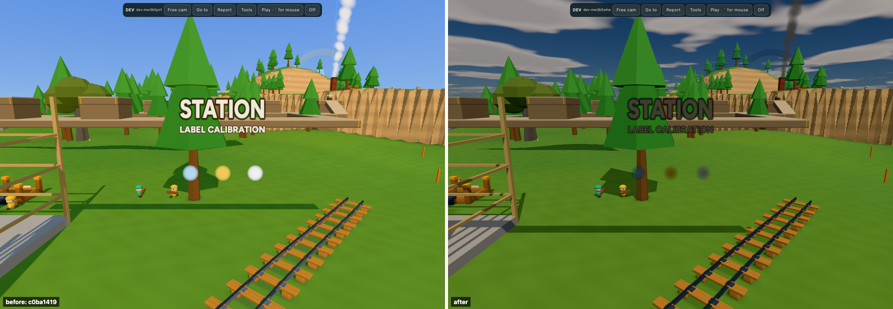
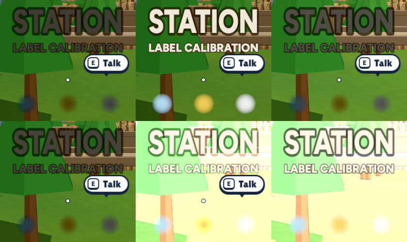
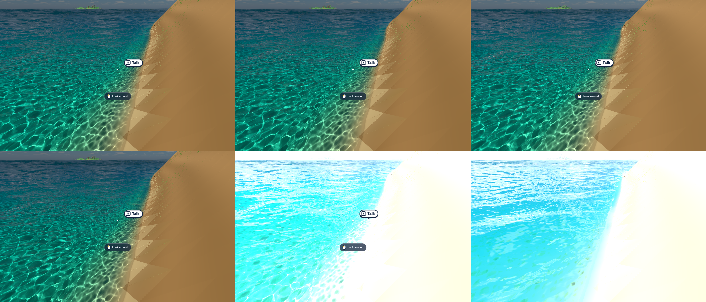
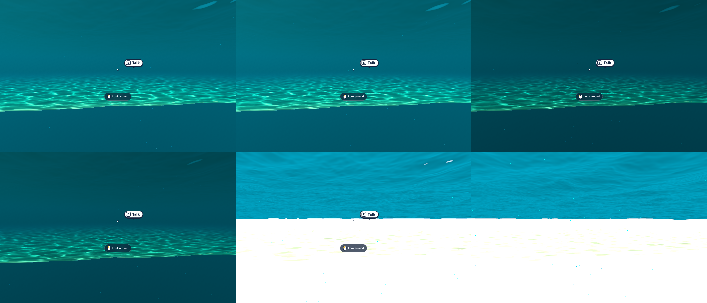

# Dark particles and floating labels: exposure or materials?

_5 November 2026. Owner's iPhone report; live primary-source research, source-family audit, matched Mac WebGPU stills and serial Metal timestamp samples. Source `7acbc2f2c865c5ce05ceeb76da40a365da67087d`, three.js 0.187.0; historical baseline `c0ba1419b832301db7d6df4a769e78d5325fb4dc`. **[M]** newly measured; **[L]** inspected code; **[H]** existing branch evidence; **[P]** primary source; **[E]** engineering estimate; **[D]** recommendation. No game-source changes. **not tested on a device**: no physical iPhone/iPad verification. Runtime diagnostic overrides below were discarded, not implemented as features._

**The regression is real, and the immediate cause is exposure applied to display-range materials. Keep HDR and Neutral; correct the readability materials first.** At the measured station camera, the meter supplies **0.091579 gain (−3.449 stops)**. The same cream label falls from **240/232/217 to 64/60/52 sRGB**, retaining **5.62% of its previous output-linear luminance**. Crystal and gold particle samples retain **5.55% and 8.63%**. Inverse-gain compensation restores all three samples exactly to the old build. Fixed or narrow exposure alone does not fix their radiance mismatch. [M]

Long term, the strongest simple-style candidate is **authored fixed exposure per lighting state, explicit underwater adjustment, and a shared brightness policy for readable unlit effects**. Narrow adaptation remains the comparison if fixed exposure fails interiors. This is a proposal, not approval to replace the owner's current look. [D]

## What changed, and what did not

The last default-old-water commit is `c0ba1419`; its child `05f46f37` switched Place to new water. **The old build already used a linear-HDR scene target, Neutral and one RenderPipeline**, with daytime renderer exposure 1. The regression is not evidence that introducing floating-point render targets was a mistake. New water brought frozen atmospheric radiance, new lighting and a full-frame meter. Today's `water=old` is ignored after graduation; use the historical commit, not that query, for this comparison. [L; [water contract](../game-design/water.md), [historical scene](https://github.com/matiasfr/boogle/blob/c0ba1419b832301db7d6df4a769e78d5325fb4dc/src/render/scene.ts)]

The path is:

```text
sRGB hex / canvas texture -> linear RGB -> unlit material -> alpha blend in HDR scene
    -> underwater composite -> multiply EVERY pixel by meter gain
    -> Neutral toe/highlight compression -> sRGB encoding -> SDR canvas
```

[`post.ts:16–48`](../../src/render/water/post.ts) meters `scenePass`, then multiplies the underwater-composited source by its gain. The meter does not isolate characters, labels, rewards or sky. [`tone.ts:86–167`](../../src/render/tone.ts) samples log luminance with a 32×32 reduction, 16 taps per texel, then 256 samples into 1×1 adaptation; clamps gain to **0.05–20**, an **8.64-stop** range; and uses rates **2.5/s toward a brighter scene, 1/s toward a darker scene**. Corresponding exponential half-times are approximately **0.277 s / 0.693 s**, except the first two updates snap. Reframing sky versus ground changes the result even with stationary lighting. The meter sees the pre-underwater scene, not the final attenuated underwater image. [L]

The hovering names are **SpriteMaterial**, from [`minis/common.ts:18–55`](../../src/proto/minis/common.ts), consumed by [`stations.ts:177`](../../src/proto/place/stations.ts) and [`halts.ts:102`](../../src/proto/place/halts.ts). Their CanvasTexture is correctly marked sRGB, and default ink is `#fff7e8`. The earlier report's `MeshBasicNodeMaterial` board is a different surface. [`particles.ts:103–114,155–160`](../../src/render/particles.ts) writes linear `THREE.Color` values to a normal-alpha SpriteNodeMaterial pool. Crystal `#bfe9ff`, box/chest sparkle `#ffd76a` and confetti white are ordinary display-range colours, with no new-water brightness compensation. These two material factories have **no diff between the historical baseline and this checkout**. [L]

Neutral compounds the low-gain loss: its minimum-channel offset is `x - 6.25*x*x` below `x=.08`, otherwise `.04`, before highlight compression. Thus `gain=.09158` is **not** an expectation of 9.158% final luminance; the toe lowers it further. This follows the installed `neutralToneMapping` in three's `ToneMappingFunctions.js:173–205` and the [Khronos implementation](https://github.com/KhronosGroup/ToneMapping/blob/main/PBR_Neutral/README.md). Neutral is designed to preserve useful colour while handling highlights, not to exempt unlit content from exposure. [L/P]

`fog:false`, high `renderOrder`, unlit shading and `toneMapped=false` are not exposure bypasses. [three's Material contract](https://threejs.org/docs/pages/Material.html#toneMapped) explicitly says the latter is ignored with render targets, postprocessing and WebGPURenderer. `renderer.toneMappingExposure` also does not control the manually transformed water output: [`post.ts`](../../src/render/water/post.ts) supplies its own gain, curve and sRGB conversion, with `outputColorTransform=false`. [L/P]

## Matched evidence and measurement method



Left is `c0ba1419` old water; right is `7acbc2f2` new water. Both use the actual shared label factory with diagnostic text and actual particle pool, **not an image simulation or replacement shader**. The three enlarged, stationary dots are crystal blue, reward gold and confetti white. Their position/size/lifetime are diagnostic; this is not a played crystal/chest/box event or proof of reward motion. The synthetic label isolates the same material used by floating names without making progression depend on camera positioning. [M]

Captured through the existing `session` and `before-after` harnesses: 1180×820, DPR 1, desktop 4× MSAA, FOV 62, Current/Neutral, bloom off, player at initial Place town spawn, same scene geometry and camera. Historical daytime held at `.24`; new frozen sky `.24`. Warm-up was 10 game seconds; camera and exposure were held for option stills. No world-stage advancement. NPCs, water and clocks continue between captures, so these are **matched-camera/material comparisons, not pixel-identical whole-scene freezes**. The historic pair passed advancing completed-frame checks, WebGPU and zero page/console/graphics errors. [M]

| Camera              | Position → target                          | Measured settled gain |
| ------------------- | ------------------------------------------ | --------------------: |
| Station calibration | `[928.186,25.2,7]` → `[928.186,23,-4.337]` |            0.09157925 |
| Shore               | `[884,8,151]` → `[868,0,144]`              |            0.11159794 |
| Underwater          | `[868,-3,144]` → `[830,-4,180]`            |            0.25575075 |

An initial ordinary player-camera reading was **0.07759547**. Therefore the brief's “about .12 outdoors” is plausible for some views, **not a calibrated global value**. Compensation for the station is **10.9195×**, not universally 8.3333×. [M]

The following table uses an identical **4,671-pixel solid-letter mask** selected from the compensated image inside rectangle `[480,265]–[695,312]` (R>235, G>225, B>210), channel medians; particle centres are `(505,459)`, `(590,459)`, `(677,459)` in the original 1180×820 PNG. They are close to opaque centres of soft dots; edge pixels include background. Decode sRGB before computing relative luminance with weights `.2126/.7152/.0722`. This is image-relative luminance, not physical screen nits. [M; [raw pixel values](dark-unlit-exposure-evidence/pixels.json)]

| Option                                     | Effective gain | Label RGB   | Crystal RGB | Gold RGB    | White RGB   | Label luminance vs old |
| ------------------------------------------ | -------------: | ----------- | ----------- | ----------- | ----------- | ---------------------: |
| Historical old                             |              1 | 240,232,217 | 177,218,240 | 240,201,91  | 240,240,240 |                   100% |
| Current                                    |        .091579 | 64,60,52    | 32,57,68    | 80,63,4     | 64,64,64    |                  5.62% |
| (a) Label/particle RGB × inverse held gain |        .091579 | 240,232,217 | 177,218,240 | 240,201,91  | 240,240,240 |                   100% |
| (b) Fixed .12, original materials          |            .12 | 80,76,67    | 43,69,81    | 91,73,6     | 80,80,80    |                  8.96% |
| (c) ±.25 EV around .12, sampled endpoint   |        .100908 | 70,66,57    | 36,61,72    | 84,67,4     | 70,70,70    |                  6.76% |
| No-tone control, HDR target retained       |              1 | 255,247,232 | 191,233,255 | 255,215,106 | 255,255,255 |                115.21% |
| (d) RGBA8 scene + output bypass ablation   |              1 | 255,247,232 | 191,233,255 | 255,215,106 | 255,255,255 |                115.21% |

The independently captured historic-new samples equal the Current row. Compensation exactly restores the historical samples, while the backgrounds retain new lighting. This is strong causal evidence for exposure/material range mismatch. It does **not** establish that every real reward event, all fog distances, or iPhone compositing is now correct. No fix was installed. [M]

### What the four options do to the same views

All three boards have the same reading order: **top row Current / (a) compensated / (b) fixed; bottom row (c) narrow / no-tone control / (d) LDR scene ablation**. Station crops are native pixels. Shore and underwater boards retain native source pixels; open them to inspect full resolution.







**(a) Compensation:** temporary runtime RGB scaling affects canvas-label materials and the shared 720-slot particle material, with alpha unchanged. It restores the label and dots, and also brightens shared train smoke: a useful warning that the pool serves dust/smoke as well as treasure. Shore and underwater treatment remain intact. Meter held constant prevents compensated effects altering the measurement; a production adaptive implementation still needs feedback-safe exposure ownership. This trial does not compensate every emissive family in the inventory. [M/L]

**(b) Fixed:** `post.autoExposure=0; post.exposure=.12`, keeping Neutral and HDR. Surface water is close to Current at this shore; label/particles remain too dim. Underwater gets visibly darker because `.12` is less than half its measured `.25575`. A fixed value is a lighting calibration, not “turn auto off and leave 1”: gain 1 overexposes this sky. An explicit medium-dependent offset is required if the current underwater readability is to survive. [M]

**(c) Narrow:** clamp the measured gain to `.12/2^.25 … .12*2^.25` = **.100908–.142705**. This session rendered those endpoint-equivalent fixed gains at each camera, **not a new running adaptive implementation**. At the shore, Current lies inside the bounds; underwater is capped too low. The existing sibling branch supplies the running implementation and underwater offset; its evidence is separated below. Narrowing stabilizes framing but cannot repair a tenfold material-range mismatch. [M/H]

**(d) No HDR:** two destructive controls distinguish removing the curve from changing storage. First bypass water post and tone mapping but retain RGBA16F; then override the renderer output-buffer type and `scenePass.renderTarget.texture.type` to `UnsignedByteType`, dispose/reallocate colour targets, align water framebuffer colour copies to that format (preserving depth), and output scene colour with only sRGB conversion. The latter really uses **rgba8unorm scene colour** (profiler inventory confirms it). Sky, sunlit land and shore clip badly; underwater loses its attenuation/shafts/lens composite and exposes a bright raw floor. [M]

**This is not a complete, retuned “no HDR anywhere” renderer.** HDR sky/PMREM and the water radiance shader remain, and other water work still executes. A genuine LDR alternative must rescale/replace those sources, preserve depth/refraction, and rebuild underwater in the new range. Merely setting `NoToneMapping` does not remove HDR targets, HDR sky memory or expensive water compute. No matched finished-LDR still or finished-LDR GPU cost is claimed. The ablation measures why deleting the current output pipeline is not a safe small fix; it does not prove an authored LDR style cannot look good. [M/L/E]

## GPU and implementation costs

Two serial three-second samples per option, headed Chromium 156, non-fallback **Apple Metal-3** adapter, 1180×820, DPR 1, 4× MSAA, same station camera. Used the existing `hardwareTiming()` earliest-start/latest-end GPU span, excluding incomplete timestamps; no sum of overlapping render/compute timings. No other capture from this task ran concurrently. Other applications' GPU use and thermal state were not controlled. The earlier visual session remained paused. All retained measurements had fresh complete spans; one sample in several runs was missing and excluded. No graphics errors in retained runs. The corrected LDR samples used a separate fresh browser with the same camera/settings; they are less tightly paired than the other options. [M; [GPU summary and actual target formats](dark-unlit-exposure-evidence/gpu-summary.json)]

| Variant                                      | GPU average ms, runs 1 / 2 | p95 ms, runs 1 / 2 | Observed render contexts |
| -------------------------------------------- | -------------------------: | -----------------: | -----------------------: |
| Current, held exposure                       |              6.281 / 5.196 |      8.381 / 6.135 |                        7 |
| (a) compensated, held meter                  |              6.123 / 5.338 |      7.837 / 6.216 |                        7 |
| (b) fixed, meter still executing             |              5.458 / 5.748 |      6.774 / 7.252 |                        7 |
| Fixed, existing Graphics meter disabled      |              5.143 / 5.406 |      6.018 / 6.515 |                        5 |
| (c) sampled narrow endpoint, meter executing |              7.538 / 5.351 |     11.819 / 6.310 |                        7 |
| (d) RGBA8/output ablation                    |              6.301 / 6.544 |      8.219 / 8.195 |                        5 |

There is **no defensible overall timing winner** from this noisy small set. The fixed-meter-off pairs save .316/.342 ms here, but these are order-dependent observations, not a guaranteed phone saving. The robust result is **two fewer render contexts**; the source also skips the history copy. Runtime compute dispatches still range 12–13. Compensation adds no pass. The narrow endpoint timing does not include a dynamically evaluated clamp; the branch's real clamp already has separate historical measurements. [M/L]

At this resolution one RGBA16F colour plane is **7.382 MiB**, RGBA8 **3.691 MiB**. The observed resolved plane plus stored 4× colour MSAA model is **36.911 versus 18.456 MiB**, saving **18.456 MiB** in that scene-colour allocation only. Excludes depth, refraction copies, post, sky, alignment and driver lifetime; not total resident memory or an iPhone configuration (touch defaults skip scene MSAA). The reduction does not remove the 1024-face HDR sky/PMREM. [M/E; [scene ownership](../../src/render/scene.ts), [sky allocation analysis](water-times-of-day.md)]

| Option                        | Smallest code ownership / work                                                                                                                                                                                                                                                                                                                            | Water consequences                                                                                                                                                                                             | Estimated effort, not measured                                                                                                                    |
| ----------------------------- | --------------------------------------------------------------------------------------------------------------------------------------------------------------------------------------------------------------------------------------------------------------------------------------------------------------------------------------------------------- | -------------------------------------------------------------------------------------------------------------------------------------------------------------------------------------------------------------- | ------------------------------------------------------------------------------------------------------------------------------------------------- |
| (a) readable RGB compensation | Shared helper/policy beside [`materials.ts`](../../src/render/materials.ts), used by [`particles.ts`](../../src/render/particles.ts), [`common.ts`](../../src/proto/minis/common.ts), then selected [`signs.ts`](../../src/proto/place/signs.ts)/tags. Distinguish reward intensity from dust; do not enumerate meshes at runtime.                        | Keeps surface and underwater pipeline; compensation before absorption still allows underwater attenuation.                                                                                                     | 0.5–1 day for a bounded fixed-reference fix/capture; 1–2 days for adaptive-safe shared history and emitter classification.                        |
| (b) fixed HDR                 | Reuse bounded branch [`post.ts`](/Users/matiasfranco/Developer/boogle-codex/color-vibrance-3/src/render/water/post.ts), width 0, existing underwater-depth signal; explicitly stop meter. Pair with (a).                                                                                                                                                  | Preserve water math; tune underwater offset and inspect interiors/entry boundary.                                                                                                                              | 0.5–1 day integration/Dev controls, 1–2 more for look calibration, not a new water system.                                                        |
| (c) narrow HDR                | Same branch, nonzero width; retain meter and rates. Pair with (a).                                                                                                                                                                                                                                                                                        | Reuse smooth depth offset; test sky/ground reframing and bobbing at waterline.                                                                                                                                 | Similar integration; 1–2 days of bounded visual/transition validation.                                                                            |
| (d) fully authored LDR        | Coordinate [`scene.ts`](../../src/render/scene.ts), [`frozen-sky.ts`](../../src/render/water/frozen-sky.ts), [`sky-core.ts`](../../src/render/water/sky-core.ts), [`surface.ts`](../../src/render/water/surface.ts), [`underwater.ts`](../../src/render/water/underwater.ts), bloom and material intensities. Retain linear blending and one sRGB encode. | Retune reflections/glitter/foam/caustics before clipping, keep scene depth/refraction, rewrite underwater range; optional bloom loses overbright threshold separation. FFT/shore simulation remains necessary. | 3–5 days for a meaningful isolated comparison, potentially 1–2 weeks for coherent replacement/device validation; no reliable measured saving yet. |

Ranges exclude owner taste iteration and are planning estimates, not approval or promises. For this style, fixed HDR captures most of the authoring simplicity of LDR while retaining highlight and underwater headroom. [D/E]

## Every affected unlit/emissive surface family in Place

This is a **source-family census**, not a count of visible instances. The global gain affects all scene colour, including lit objects; this inventory answers the requested unlit/emission subset. Progress, visibility, distance, cosmetics and peers determine which instances exist. Buddy GLB has four materials and no authored emissive/unlit extension; runtime body fill is included. `place-kit.glb` and `hero-clips.glb` have no materials; kit replacement retains code-owned materials. [L]

| Surface family                                                | Owner and range                                                                                                                                                                                               | Compensation disposition                                                                              |
| ------------------------------------------------------------- | ------------------------------------------------------------------------------------------------------------------------------------------------------------------------------------------------------------- | ----------------------------------------------------------------------------------------------------- |
| Hovering station names/bills; halt names                      | [`stations.ts:177`](../../src/proto/place/stations.ts), [`halts.ts:102`](../../src/proto/place/halts.ts) → [`common.ts:25`](../../src/proto/minis/common.ts), SpriteMaterial canvas, `#fff7e8`                | Readability candidate                                                                                 |
| Fork signs, room wall/standing boards, plaques                | [`signs.ts:35`](../../src/proto/place/signs.ts), [`rooms.ts:319,336`](../../src/proto/place/rooms.ts), Basic canvas, paper `#fff3d6`                                                                          | Readability candidate; preserve ink/paper contrast                                                    |
| Shop prices                                                   | [`shop.ts:163`](../../src/proto/place/shop.ts), Basic canvas atlas                                                                                                                                            | Readability candidate                                                                                 |
| All shared particles                                          | [`particles.ts:103`](../../src/render/particles.ts), 720-slot SpriteNodeMaterial, normal alpha                                                                                                                | Classify reward glints versus dust/smoke; not all are lights                                          |
| Box/chest halos, reward flash/shaft; held-up reward halo/rays | [`gifts.ts:957–1040`](../../src/proto/place/gifts.ts), [`got.ts:46–48`](../../src/proto/place/got.ts) → [`look.ts:245`](../../src/proto/place/look.ts), additive Basic `softGlow`; strength currently opacity | Author RGB intensity separately from opacity                                                          |
| Headlamp glass/cones; path/deck lamps                         | [`rail.ts:581–582`](../../src/proto/place/rail.ts), [`lamps.ts:16`](../../src/proto/place/lamps.ts); HDR Basic `[3.2,2.7,1.5]` / `[3,2.1,.9]`, separate additive beam                                         | Already HDR-valued; calibrate separately                                                              |
| Hook halo and device shafts                                   | [`tech.ts:212,278`](../../src/proto/place/tech.ts), Basic `#e8fffa` and additive TEAL                                                                                                                         | Readability/fictional glow decision                                                                   |
| Museum specimen haze and blue pool                            | [`museum.ts:234,238`](../../src/proto/place/museum.ts), softGlow/additive Basic                                                                                                                               | Calibrate intentional glow                                                                            |
| Ground contact patches                                        | [`look.ts:279–289`](../../src/proto/place/look.ts), Basic `[.04,.06,.08]`, opacity ≤.3                                                                                                                        | Intentionally dark; exclude                                                                           |
| Crystal clusters and collected shelf crystals                 | [`crystals.ts:28–45`](../../src/proto/place/crystals.ts), Standard emission `#58c8ff ×1.5`                                                                                                                    | Tune emission independently of lit body                                                               |
| Far-land floating shard                                       | [`land.ts:251`](../../src/proto/place/land.ts), emission `#58c8ff ×1.6`                                                                                                                                       | Same distinction                                                                                      |
| Gold finds                                                    | [`props.ts:40–45`](../../src/proto/place/props.ts), emission `#7a5a08`                                                                                                                                        | Modest material fill, not UI                                                                          |
| Forge mouth / machine firebox                                 | [`forge.ts:94`](../../src/proto/place/forge.ts), [`rail.ts:600,711`](../../src/proto/place/rail.ts); orange emission ×1.3 / animated fire                                                                     | Calibrate glow; do not boost all Standard materials                                                   |
| Device rings/cores/pad undersides                             | [`tech.ts:65–68,139,298–303`](../../src/proto/place/tech.ts), TEAL emission ×1.8                                                                                                                              | Gameplay signal candidate                                                                             |
| Ancient gate faces and apron band                             | [`tech.ts:535–536,670`](../../src/proto/place/tech.ts), warm emission ×.18 / TEAL ×.9                                                                                                                         | Separate fill from signal; seam/posts are lit, not emissive                                           |
| Hook cable                                                    | [`moves-view.ts:26`](../../src/proto/place/moves-view.ts), TEAL emission ×.5                                                                                                                                  | Gameplay signal candidate                                                                             |
| Museum lining/core                                            | [`museum.ts:206,227–228`](../../src/proto/place/museum.ts), emission .22–1.5 / core ×3                                                                                                                        | Already intensity-authored                                                                            |
| Interior/furniture fill                                       | [`rooms.ts:55`](../../src/proto/place/rooms.ts), vertex-colour emission ×.12                                                                                                                                  | Part of lighting balance                                                                              |
| Fake steel sky fill                                           | [`look.ts:159,168`](../../src/proto/place/look.ts), `emissiveNode=skyOnSteel()`, rust attenuated                                                                                                              | Applies to steel kit/rails/train; retain lighting semantics                                           |
| Buddy and capsule body fill, local/remote                     | [`avatars.ts:91–95`](../../src/player/avatars.ts), [`buddy/rig.ts:178–185`](../../src/player/buddy/rig.ts), main colour emission ×.15                                                                         | Do not treat as display UI                                                                            |
| Remote player names                                           | [`avatars.ts:159`](../../src/player/avatars.ts), [`name-label/view.ts:27`](../../src/components/name-label/view.ts), sRGB canvas SpriteMaterial                                                               | Readability candidate                                                                                 |
| Honk notes / group sparkles                                   | [`honk.ts:188,205`](../../src/features/honk.ts), SpriteMaterial                                                                                                                                               | Readability candidate; sparkle canvas lacks notes' explicit sRGB annotation at :180, a separate issue |
| Ping ground ring                                              | [`ping.ts:134`](../../src/features/ping.ts), Basic, opacity .9                                                                                                                                                | Readability candidate; DOM ping card unaffected                                                       |
| Impact/flop stars                                             | [`impact.ts:270–295`](../../src/features/impact.ts), feedback SpriteMaterial                                                                                                                                  | **Already gain 6 new / 1.5 classic**; reconcile existing boost, never multiply twice                  |
| First-arrival cloud deck                                      | [`fall/stage.ts:101`](../../src/fall/stage.ts), Lambert emission `#e6f0ff ×.55`                                                                                                                               | Intro-specific lighting calibration                                                                   |
| Sea surface, marine snow                                      | [`surface.ts:493`](../../src/render/water/surface.ts), [`snow.ts:51–66`](../../src/render/water/snow.ts), Basic/SpriteNode classes with HDR water lighting                                                    | **Exclude from display-range compensation**                                                           |
| Frozen sky, solar disc/background                             | [`frozen-sky.ts:106`](../../src/render/water/frozen-sky.ts), HDR environment background                                                                                                                       | Metered scene radiance, not UI                                                                        |

Shared particle callers cover crystal bursts (`crystals.ts:84`); shelf reveals/box/chest sparkles/confetti (`gifts.ts:631,1050,1070`); held reward (`got.ts:165`); celebrations (`celebrate.ts`); chips/dust (`pieces.ts:229,251`, `chop.ts:445,880`); forge (`forge.ts:339`); smoke/rail sparks (`rail.ts:620,732,907`); devices (`tech.ts:363`); movement (`moves-view.ts:76,247`); finds (`props.ts:68`); folk/town (`folk.ts:507`, `town.ts:281`); Place entry and shared splash/impact effects. All use the same RGB policy. [L]

Classic content is still eagerly loaded off-area: work-site rings/plaques (`features/work-sites.ts:50–75`), Boogler hearts/gifts/pop (`boogler/fx.ts:56,92,107`), lighthouse glass/lamp/halo (`pois/lighthouse/index.ts:274–321`), cave crystals/lanterns (`pois/caves/decor.ts:372,547`), classic gift sprites (`adapters/gifts.ts:107`), fish emission (`features/critter-fish.ts:47`). They would be exposed if brought into view, but are not ordinary town surfaces. Legacy sky/clouds are hidden by frozen sky; fireflies/night blobs are night-gated with frozen day=1; throw previews exist but Place hides their normal controls. `rooms.ts:56` shadow proxies have `colorWrite:false`. Offscreen caustic/sky/ambient bake quads are calculations, not visible label surfaces. DOM HUD, carry counts, prompts, dialogue, reward cards and Dev bypass this pipeline entirely. [L]

## What standard renderers and primary sources suggest

| Source                                                                                                                                                                                | Verified lesson                                                                                                                                                               | Boogle consequence                                                                                                                                                                     |
| ------------------------------------------------------------------------------------------------------------------------------------------------------------------------------------- | ----------------------------------------------------------------------------------------------------------------------------------------------------------------------------- | -------------------------------------------------------------------------------------------------------------------------------------------------------------------------------------- |
| [Unity HDRP Unlit shader documentation](https://docs.unity.cn/Packages/com.unity.render-pipelines.high-definition@7.7/manual/Unlit-Shader.html)                                       | Unlit means unaffected by lighting; separate emissive intensity and exposure weight exist. This is explicitly version 7.7 documentation, not a claim about today's UI layout. | Expose the distinction between authored colour, glow power and exposure response. A material being “unlit” does not imply constant displayed brightness.                               |
| [Google Filament materials](https://google.github.io/filament/main/materials.html)                                                                                                    | Emission has linear HDR RGB and exposure weight; unlit materials can encode exposure-independent output.                                                                      | A small shared material policy is a standard solution; do not hand-boost dozens of unrelated colours.                                                                                  |
| [Unreal auto exposure](https://dev.epicgames.com/documentation/en-us/unreal-engine/auto-exposure-in-unreal-engine)                                                                    | Basic mode uses average log luminance, histogram offers finer control, manual is independent of frame luminance; metering masks and bounds stabilize exposure.                | Boogle's full-frame log meter is conceptually Basic, not histogram. Fixed or narrowly bounded gain is legitimate; a histogram/local-exposure system is unnecessary scope for this fix. |
| [Godot environment and postprocessing](https://docs.godotengine.org/en/stable/tutorials/3d/environment_and_post_processing.html)                                                      | Practical camera attributes offer artist-friendly units separately from physical camera controls; environment, exposure and tone mapping are distinct concepts.               | Give the owner direct brightness/EV and bounds, not an unexplained camera simulation or one ambiguous “HDR” toggle.                                                                    |
| [Khronos PBR Neutral](https://github.com/KhronosGroup/ToneMapping/blob/main/PBR_Neutral/README.md) and [three RenderOutputNode](https://threejs.org/docs/pages/RenderOutputNode.html) | Tone mapping handles scene-to-display range; explicit output transforms require the pipeline's automatic transform disabled.                                                  | Preserve linear blending and exactly one output conversion. Retaining Neutral does not require retaining broad auto exposure.                                                          |

These are implementation precedents, not claims that any engine default matches Boogle's artistic needs. The [GDC listing for John Hable's Uncharted 2 HDR talk](https://gdcvault.com/play/1012459/Uncharted-2-HDR) was checked for its HDR/highlight/material scope; its video was not watched and supplies no numeric claim here. Nothing in that realistic-game precedent justifies photographic adaptation for this toy palette. [P/D]

## Reuse `codex/color-vibrance-3`; do not build the controls twice

Audited branch **`f25ee48493b70bbd71777efcd19934d536ce33f9`**, not merged into this checkout or verified pushed; the following links are local-only. Its [report](/Users/matiasfranco/Developer/boogle-codex/color-vibrance-3/docs/research/color-vibrance-3.md), [post implementation](/Users/matiasfranco/Developer/boogle-codex/color-vibrance-3/src/render/water/post.ts) and [shot list](/Users/matiasfranco/Developer/boogle-codex/color-vibrance-3/dev/look/beats/color-vibrance-3.ts) are the owning prior work. Local checkout: `/Users/matiasfranco/Developer/boogle-codex/color-vibrance-3`. [L]

| Already exists                                                 | Exact coverage / remaining gap                                                                                                                                                                                                 |
| -------------------------------------------------------------- | ------------------------------------------------------------------------------------------------------------------------------------------------------------------------------------------------------------------------------ |
| Branch `post.bounded=0`, `post.centre=.12`, `post.widthEV=.25` | GPU clamp in existing output; width 0 is fixed. No extra pass. Gated by `import.meta.env.DEV && proto=place&dev=1`. **Bindings only, no visible panel rows.**                                                                  |
| Branch `post.underwaterEV=1.22`                                | Uses existing signed camera-depth signal, smoothstep over 0–1.5 m; centre .12 → .27954. No new depth compute. Meter still runs at width 0.                                                                                     |
| Current Water/Post UI                                          | Exposure .25–4, autoExposure 0/1, keyValue .05–.6, contrast/saturation, AgX parameters, bloom and quality. **Exposure slider cannot reach .12**; auto-off changes exposure's meaning from multiplier to absolute gain.         |
| Current Looks                                                  | Current/Clean/Sunny/Punchy/Sunshine; A/B, keyboard and touch swap, exposure lock, per-look trims, persisted settings and copied snapshot including sampled meter gain. Lock holds history; it is not an authored fixed centre. |
| Current Graphics                                               | Meter toggle stops its two draws/history copy, holding last value; it does not choose a fixed gain. MSAA/resolution and profiling controls already exist.                                                                      |
| Current Dev camera/evidence                                    | Free camera, bookmarks, PNG/report export, reusable shot lists and hardware profiler. Extend these; no second tuning app, screenshot harness or exposure owner.                                                                |

**Prior measurements are not exposure-only comparisons.** The fixed/narrow candidates keep round-two key 1.12, fill 3.2, selective pigments, grass pigment .35/albedo .7 and keyValue `.18*2^.25`. Its close `OPEN TO OFFERS` board uses `[892,20,12]→[886,20,11]`, FOV62, and is **not the station label**. Current board RGB 74/43/30 at gain .11901; fixed .12 gives 75/43/30, narrow lower bound gives 67/38/25. Nearby furnished doorway Current gain is .233. Its underwater fixed-without-offset volume was −30.7%, +1.22 EV offset +4.6%, narrow +3.7%, with wave-phase/readback limits. [H]

The branch's six-second running views and waterline/walk evidence are useful adaptation evidence; this report's static clamp endpoint is not a replacement. Historical GPU narrow/round2 averages **6.304/6.341 ms**, fixed/narrow **6.511/6.398 ms**, all seven passes: noise-sized differences, no meter-removal or LDR test. The branch ranks round two first, narrow as best new candidate, and reports sand/sky regressions. It is **not an approved production look**. [H]

## Numbered recommendations for Boogle

1. **Fix the reported readability regression before changing the whole look.** In [`particles.ts`](../../src/render/particles.ts) and [`minis/common.ts`](../../src/proto/minis/common.ts), use one shared authored brightness policy, then apply it selectively to [`signs.ts`](../../src/proto/place/signs.ts), shop tags and remote names. Smallest bounded implementation: a single adjustable reference-gain multiplier for these classes, preserving alpha, with Current untouched elsewhere. The measured station needs 10.92×; 8.33× is only a .12 calibration. Do not boost all Basic materials, contact blobs, water, or already-boosted impact stars. If particles need separate dust/reward behavior, add intensity to the existing emitter/pool rather than a second pool. Serves **Telegraph everything**. [D]

2. **Prefer fixed HDR plus explicit material brightness as the long-term simple-style candidate; keep narrow adaptation as the fallback comparison.** Reuse the branch's bounded owner in [`post.ts`](../../src/render/water/post.ts) with width 0 and the existing underwater-depth offset, preserving Neutral, surface/refraction and underwater. Disable meter work in fixed mode. Compare this combined material+exposure choice with narrow ±.25 EV, including actual rooms and waterline motion, before adopting it. Neither .12 nor +1.22 EV is universal or owner-approved. This differs from the sibling report's ranking because that report compares a different lighting/pigment package, not this isolated regression. [D]

3. **Make adaptive compensation feedback-safe if retained.** Do not put a sample of the current frame's meter into a material rendered by the scene the meter samples: that creates a scene→meter→scene dependency. Use a shared previous-frame exposure representation, with consistent output timing and bounded response, or fixed-reference intensity. Do not add per-frame CPU GPU readbacks. Large compensated effects can bias a full-frame meter; test reward fills and sky/ground turns, and only add masking/exclusion if needed. Keep this inside [`tone.ts`](../../src/render/tone.ts)/[`post.ts`](../../src/render/water/post.ts) ownership. A later display-space label layer is a larger alternative because it must preserve depth occlusion, fog and underwater attenuation. [D]

4. **Expose existing branch controls in the existing Dev panel.** Extend [`water-tuning.ts`](../../src/debug/water-tuning.ts), [`debug/dev/water.ts`](../../src/debug/dev/water.ts) and [`looks.ts`](../../src/render/water/looks.ts), not another panel: Auto / Narrow / Fixed selector; centre gain with EV equivalent (allow .01–2); half-width in stops (0–1); underwater offset (0–2 EV); raw/effective gain and clamp status; explicit material brightness for labels/reward particles, independent of opacity. Reuse `post.bounded/centre/widthEV/underwaterEV`, existing A/B/reset/copy/bookmarks, and label lock versus fixed accurately. Copy build, camera, raw/effective gain, material factors, resolution/MSAA and underwater state. A visible calibration/reward trigger should use existing factories and keep the same camera. [D]

5. **Defer full HDR removal unless an authored LDR proof wins on both appearance and measured cost.** The current ablation clips the accepted sea/sky and removes underwater composition; its two fewer passes are also achievable by disabling metering while retaining HDR. A future proof must keep depth/refraction and underwater, normalize lighting/sky/material ranges, inventory actual target formats, and measure warmed steady-state plus waterline transitions. Compare against fixed HDR at equal resolution/MSAA, not the broken bypass. Follow [`water-graduation.md`](../plans/water-graduation.md) ownership and the owner's retained-water decision. [D]

6. **Stop at a small owner comparison after the combined fix is implemented and checked.** One station/reward view, one interior, one shore/underwater crossing, touch-accessible A/B; ask which preserves cheerful, readable toys. Inspect emitted crystal/chest/box events, reward-versus-dust distinction and impact-star double boosts before handing it over. Stills do not establish adaptation comfort or phone behaviour. Keep real-time motion and the iPhone result explicitly unverified until that playtest. [D]

## Reproduction, retained artifacts and limits

All source edits are absent; committed changes are this research, its index and evidence. Scratch diagnostic scripts are `.look/setup-probe.ts`, `measure.ts`, `calibration.ts`, `emit-calibration.ts`, `hardware.ts`, `ldr-stills.ts`, `pixels.ts`; original stills are `.look/session/`, historical pair `.look/exposure-history-particles-*`, full runtime measurements/timestamp samples `.look/dark-evidence/`. These scratch paths are local and ignored; the linked PNG boards and pixel/GPU summaries above are committed evidence.

Historical capture used the repository's comparison command (its standard read-only package symlink points to **this worktree's installed dependencies**, not the caller's):

```sh
npm run before-after -- c0ba1419 --query 'proto=place&dev=1&tod=0.24' \
  --eval .look/calibration.ts --action .look/emit-calibration.ts \
  --cam 928.186,25.2,7 --look 928.186,23,-4.337 --warm 10 --size 1180x820 \
  --name exposure-history-particles
```

To recreate the fixture without scratch files: call the real `label(3.4,1.7)`, set `STATION` / `LABEL CALIBRATION`, place at `[928.186,24.8,-3]`; emit three dots at `[926.9+1.3*i,22.5,-3]`, colours `#bfe9ff/#ffd76a/#ffffff`, life 300, size .65, zero gravity/drag, grow `[1,1]`, no fade/shrink. Emit **after** warm-up (the preliminary before-warm emit did not survive visibly and was replaced). Use the cameras above. Sample meter through Looks lock; retain this scalar for static comparisons. Multiply RGB, not alpha, by its reciprocal for (a); use existing bindings for fixed/clamped gains. The LDR ablation changes runtime target/output and matching colour-copy formats as described. An initial target-only edit was reset to half-float by three PassNode setup; forcing RGBA8 then exposed a half-float refraction-copy mismatch. A correction accidentally included depth textures and failed validation. Those trials were discarded. The final colour-only correction preserved depth, verified RGBA8 allocations, and produced zero graphics errors; its stills were recaptured without the profiling overlay. A first compensation probe accidentally selected marine snow rather than the 720-slot pool; it was discarded and rerun. Committed numbers/images use the corrected pool. [M]

Initial visual harness commands inherited Node 24.11.1; the corrected option runner and hardware measurements used installed **Node 26.13.0**. The browser renderer and installed lockfile dependencies were the same. Main source remains `7acbc2f2`; old/new material files were diff-checked. Live-source references were opened 5 November. No real game/reference-game binary, phone, perceptual test, full HDR removal, newly implemented running narrow controller or dynamic reciprocal compensation was tested. HDR means scene/storage range here, **not an HDR display mode**.

The remaining evidence gap is explicit: **a complete retuned no-HDR renderer has neither matched stills nor measured cost**. Its destructive scene/output ablation is measured; its implementation cost is estimated. This research can support the small material fix and a fixed/narrow Dev choice, but cannot approve full HDR removal. No deployment, push, ship or gameplay change is part of this report.

Validation: Prettier ran on both Markdown files and both evidence JSON files with the repository Markdown ignore overridden; targeted lint reported zero problems. Local report links resolve and `git diff --check` passed. No game-source changes required a build or gameplay suite.
