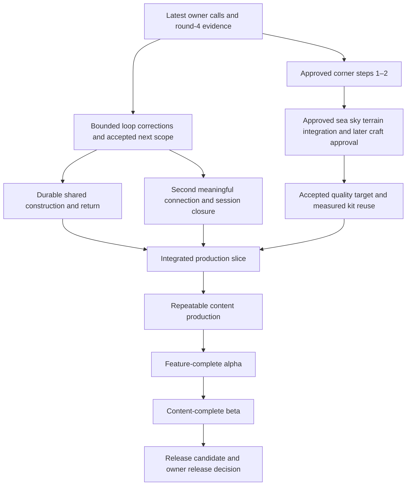

# Game direction: keep the vision, choose the next proof

> **Verdict:** One game-direction skill, a derived direction doc, a narrow AGENTS.md trigger.
> **Top recommendations:** 1. Use one game-direction skill, a small derived direction doc and a narrow AGENTS.md trigger.
> **Status:** adopted. See [direction-skill-test](direction-skill-test.md).

_Research report, 3 November 2026. Small-team game production, creative direction, dependency ordering and a shared Codex/Claude direction workflow. Repository inspected at `993416e2a5c54df23156cc4651030effb0b6b06f`; live web research conducted for this report. Includes a proposed phase map, eight recommendations, an install-ready skill draft and three worked answers. Proposal only: the owner decides. No skill, agent, gate or roadmap is installed by this report._

**Evidence:** **[V]** primary-source text, developer interview answers or slide text read this run; **[A]** talk abstract only; **[S]** secondary reporting; **[R]** repository file inspected; **[D]** synthesis for Boogle; **[H]** proposed criterion, not a measured result. Videos were not watched. No new gameplay or device test was run. Existing playtest and test results below are attributed records, not independently repeated results.

## Recommendation in one paragraph

**Use one repo-owned `game-direction` skill, a small derived direction document, and a narrow trigger in AGENTS.md.** The skill performs the game-director function: preserve the intended experience, identify the next uncertainty, work backward through prerequisites, and recommend what to do or defer. A dedicated agent is an optional executor later, not the source of authority or memory. Keep decisions in [decisions.md](../decisions.md#current-decision-index), principles in [DESIGN.md](../../DESIGN.md), implementation order in the owning plans, and evidence in playtests/as-built reports. The director may challenge an order of work; only the owner changes direction or approves a new stage. Other agents defer to that recorded direction and the consultation procedure, not to an agent's unsupported opinion. **[D]**

**Boogle is in late discovery / integrated pre-production, after a meaningful round-4 co-op playtest, with production-readiness work still ahead.** It has more than disconnected toys, but neither a demonstrated production vertical slice nor a feature-complete alpha. The immediate recommendation is to reconcile the latest notes and existing fixes into a bounded next plan, then prove durable shared construction and the accepted efficiency loop. A beautiful corner is a parallel, explicitly bounded quality experiment, not evidence that the whole game is ready for content production.

## What the checkout actually establishes

The requested `docs/plans/round-4-notes.md` is absent. Its relevant substitute is [the 3 November round-4 entry in playtests.md](../playtests.md#2026-11-03-round-4-two-players-the-default-url), followed by the explicit **3 November, after round 4** owner calls in [The shape of the game](../decisions.md#the-shape-of-the-game). The [round-4 queue](../plans/round-4.md#queue-codex-until-the-playtest) and the opening of [beautiful-corner.md](../plans/beautiful-corner.md) still contain pre-playtest wording. Do not wait for a playtest that the newer record says happened; equally, do not convert those notes into blanket approval of every suggested mechanic. The owner's survey is still pending in that record. **[R]**

| Area                   | Checked evidence                                                                                                                                              | What it permits us to conclude                                                                                                                                                                                                                       |
| ---------------------- | ------------------------------------------------------------------------------------------------------------------------------------------------------------- | ---------------------------------------------------------------------------------------------------------------------------------------------------------------------------------------------------------------------------------------------------- |
| Vision                 | [DESIGN](../../DESIGN.md#the-core-loop); current [shape](../decisions.md#the-shape-of-the-game)                                                      | Building, ability-led exploration and incremental growth matter equally. Path first; tools/carry/nearer supply; trains later. Roughly eight hours is a direction, not proven duration. Materials/upgrades supersede global eras.                     |
| Human loop evidence    | [Round-4 playtest](../playtests.md#2026-11-03-round-4-two-players-the-default-url)                                                                            | Two familiar players found relief from helpers and delivered rails, enjoyed chopping and abilities, and found late rail errands tedious. This is encouraging evidence for the ladder, not blind onboarding or an hour-to-hour campaign test.         |
| Co-op benefit          | [Place measurements](../game-design/place.md#the-run), [two-player evidence](../plans/two-player.md#implementation-evidence-3-november-steps-48)              | The recorded Q5 fixture took 162.40 s solo, 115.14 s with two walkers and 80.90 s with split jobs. Different starting positions and one station limit the comparison; it is not a whole-game speed multiplier.                                       |
| Human failure evidence | Same round-4 notes                                                                                                                                            | Cart launch, unreliable rides, missing partner cargo and a freeze were reported. Those observations must survive in the record, even after fixes.                                                                                                    |
| Later fixes            | `git log` and [current place description](../game-design/place.md#the-run)                                                                                    | Commits `93b86aa6`, `9c8bda58`, `2691519c`, `4128e0aa` and `d3ba332e` address instance bounds, rides, partner loads and cart recall. Do not list each old symptom as an unfixed current bug. A full new human run is not established by this report. |
| Production authority   | [`job.ts`](../../src/proto/place/job.ts), `sharedSlice`, `save`, `restore`; [`coop.ts`](../../src/proto/place/coop.ts), `authorityPeer` and snapshot protocol | Round 4 uses tab-owned railway state and room-keyed localStorage, with a temporary authority among tabs. Existing server-hosted rooms do not make this particular progression server-owned.                                                          |
| Conversion             | [Mainline architecture, findings 1–7](../plans/mainline-architecture.md); [round-4 afterword](../plans/round-4.md#after-this-round)                           | Becoming the default URL did not complete production conversion. The findings are preparation, not an approved implementation plan. Preserve accepted behavior while changing ownership/lifetime.                                                    |
| Craft                  | [Beautiful corner approved scope and steps](../plans/beautiful-corner.md#ordered-work-after-approval)                                                         | Steps 1–2 have a bounded approval and recorded rough-fit evidence. Later sea/sky/terrain integration and owner reviews remain gates; one finished job plus measured reuse is the target, not a completed result.                                     |
| Campaign/content       | [Rail-slice draft](../plans/rail-slice.md), [current decision index](../decisions.md#current-decision-index)                                         | The older slice still uses era framing and is awaiting approval. Its title, old timing and checkboxes cannot establish a current eight-hour production plan.                                                                                         |

There is no nested AGENTS.md in `docs/` or `.claude/` in this checkout; the focused source inspection was in `src/proto/place/`, which also has none. No high-risk simulation, networking or renderer implementation was audited here. A future conversion planner must explicitly load those folders' nested instructions; reading this report does not satisfy that obligation.

## Production patterns: what the sources support

### Mark Cerny and Michael John: discovery and manufacture are different jobs

**[V]** Their original _Myth vs. Method_ distinguishes exploratory pre-production from production, puts experienced people on early prototypes, and requires a convincing first playable that demonstrates variety and key technology. It separates macro design from detailed level design and makes gameplay testing central. Its first playable is considerably stronger than “the executable starts.” [Original article, printed pp. 32–36](https://media.gdcvault.com/GD_Mag_Archives/GDM_June_2002.pdf).

**[D]** Borrow the transition criterion: prove what we are making and how another representative piece gets made before multiplying it. Do not borrow the article's number of prototype levels, staffing or calendar as a small browser game's formula. “Cerny's Method guarantees success” and “all studios use exactly this process” are folklore, not established by this source. Polishing one representative experience can be legitimate pre-production; polishing every uncertain feature cannot.

### Rami Ismail: the slice tests the production process

**[V]** Ismail distinguishes prototypes that test whether an idea is worth making from a vertical slice that tests the ability to produce it. He recommends building a second representative thing to expose the repeatable cost after initial setup. [Prototypes & Vertical Slice](https://ltpf.ramiismail.com/prototypes-and-vertical-slice/).

**[V]** His milestone guide calls alpha core-feature-complete and beta content-complete, while warning that its sequence is an idealization. Content can be built before alpha; the distinction concerns what remains uncertain. [Milestones](https://ltpf.ramiismail.com/milestones/).

**[D]** Use evidence gates rather than importing calendar estimates. Boogle's station kit needs a second fitting; its loop needs a second meaningful connection; neither is proved by a prettier screenshot of the first. Define milestone words locally so an agent cannot promote “playable” into “alpha.”

### Valve: vision can be a playable composition

**[V]** Ken Birdwell describes impressive pieces that did not make a coherent Half-Life. A small group combined working ideas into a prototype level, removed failures and established a shared target. The cabal included people who would actually make the work. [The Cabal, developer retrospective](https://www.gamedeveloper.com/design/the-cabal-valve-s-design-process-for-creating-i-half-life-i-?trk=article-ssr-frontend-pulse_little-text-block).

**[V]** Valve's later design slides describe goals, experiments and playtests driving production; creators observe external players without supplying solutions. [Half-Life 2 design process, slides 2–15](https://cdn.fastly.steamstatic.com/apps/valve/2006/GDC2006_HL2DesignProcess.pdf).

**[D]** Boogle needs one integrated build and one person accountable for interpreting it, not a committee of agents voting on taste. A director should reconcile construction, travel, exploration and rewards in the same run. Cabals do not establish that hierarchy is always wrong or that individual departments should independently approve the game. Nor do these sources establish that agent-written playtest summaries substitute for watching humans.

### Nintendo: a pillar changes the dependencies

**[A]** Fujibayashi, Takizawa and Dohta's [GDC 2017 session](https://www.gdcvault.com/play/1024562/Change-and-Constant-Breaking-Conventions) is the primary talk reference; only its abstract was inspected. **[S]** Contemporary reporting describes freedom as the intended experience: climbable walls create a need to get down, gliding answers that need, and interacting systems allow combinations beyond individually scripted puzzles. [Contemporary account of the talk](https://www.thumbsticks.com/gdc-17-breaking-conventions-breath-of-the-wild/). The often-retold early top-down prototype is secondary evidence in the existing [finding-the-fun report](finding-the-fun.md#nintendo), not newly verified footage here.

**[D]** The useful lesson is a causal chain from experience to mechanics to content requirements. For Boogle, a distant reachable promise needs a legible route and a satisfying way home. A hook or glider needs a meaningful spatial use. “Nintendo builds all fun before doing any art” is not supported; neither is using its world size or schedule as Boogle's target.

### Supergiant: stable intent with a format that tolerates learning

**[V]** Greg Kasavin identifies specific starting intentions for Hades: narrative integrated with its repeated runs, responsive action, interconnected systems and building on the team's strengths. [Kasavin's development account](https://blog.playstation.com/2021/08/05/the-origins-of-hades-out-next-week-on-ps5-ps4/). Supergiant says Early Access was planned from the outset and influenced the modular structure and narrative, rather than being added as a release label. [Studio FAQ](https://www.supergiantgames.com/blog/hades-faq/).

**[D]** Hold the experience stable while permitting the means to change. Boogle can keep the desire for efficiency while changing when rails arrive. It should not copy a roguelike's content cadence or infer that Early Access makes an unfinished core safe. This evidence does not expose a universal Supergiant one-page template, exact kill threshold or director approval procedure; none is claimed.

### Team Cherry: spatial coherence and subtraction

**[V]** In direct interview answers, Ari Gibson and William Pellen describe blocking spaces, testing movement, dressing them and placing interactions. They cut Bone Forest partly because of production scope and partly because the world was already demanding to comprehend. They emphasize coherent connections. [Team Cherry map-design interview](https://www.pcgamer.com/how-to-design-a-great-metroidvania-map/).

**[D]** Exploration depends on traversable relationships, not a list of beautiful destinations. Prototype Boogle's ability routes and returns before multiplying islands. Cutting a large area can improve the game. “Three people made a huge world, so our agents can make unlimited islands” ignores production conditions and the cuts; no productivity multiplier follows from the interview.

### Tynan Sylvester: pillars must reject attractive work

**[V]** Sylvester's RimWorld slides use its story-generation pillar to reconsider failure and presentation. They describe regularly reprioritized ideas, learning that arrives after plans, and a hard question about whether a feature is actually necessary to ship. [GDC 2017 slides, especially 2–5 and 11–16](https://media.gdcvault.com/gdc2017/Presentations/Sylvester_Tynan_RimWorld_Contrarian_Ridiculous.pdf).

**[D]** Retain ideas without treating them as commitments. Ask what observable player experience an addition supplies and what simpler existing feature could supply it. Boogle already has [ideas.md](../ideas.md); the director needs no second backlog of dreams. A flexible next step and a defined finish are compatible. A pillar is useful when it says no, not when every possible feature can claim to serve it.

### Co-op practitioners: three different promises, three different production problems

| Game and evidence                                                                                                                                                             | Supported observation                                                                                                                                                                                                                                 | Boogle implication and limit                                                                                                                                                                                                                                                                              |
| ----------------------------------------------------------------------------------------------------------------------------------------------------------------------------- | ----------------------------------------------------------------------------------------------------------------------------------------------------------------------------------------------------------------------------------------------------- | --------------------------------------------------------------------------------------------------------------------------------------------------------------------------------------------------------------------------------------------------------------------------------------------------------- |
| **Valheim [V/A]**: [Iron Gate FAQ](https://valheim.com/faq/); [Smårs's GDC 2024 talk listing](https://www.gdcvault.com/play/1034494/Independent-Games-Summit-Valheim-Vikings) | The studio supports solo and co-op. Its FAQ records withdrawing the initial roadmap to prioritize stability after launch, and describes resource/biome progression. The GDC recording was not watched; the fetched listing redirected to maintenance. | **[D]** A shared building world needs dependable return and transport before a large content promise. Adopt adaptable milestone gates, not Valheim's combat gates, survival costs or development duration. The FAQ mixes old roadmap wording with newer updates; only the historical explanation is used. |
| **Deep Rock Galactic [V]**: [Akopyan's GDC 2023 slides, 5, 13, 18–23](https://media.gdcvault.com/gdc2023/Slides/DevelopingALiveGame_Akopyan_Mikhail.pdf)                      | Exploration, action and cooperation are explicit pillars, supported by terrain, traversal and complementary characters. The slides call the initial update rush unsustainable and show later experimental feedback before public releases.            | **[D]** Complementary jobs need the whole environment and delivery loop, not merely two avatars. Keep feedback time in the plan. Its successful live-game evolution does not require Boogle to become a live service, add combat classes or release seasons.                                              |
| **It Takes Two [V]**: [Fares interviewed by Epic](https://www.unrealengine.com/developer-interviews/it-takes-two-lovingly-marries-story-and-gameplay-together?lang=en)        | Fares explicitly connects mechanics to the story's changing situations and co-op-only intent. This is an authored, paired experience rather than proof that one reusable loop suits every game.                                                       | **[D]** Make each shared activity express the intended relationship. Borrow complementary actions for Boogle's optional two-person toys; mandatory paired campaign gates would conflict with its solo/drop-out promise. Bespoke mechanics for every scene are a content burden, not a small-team default. |

**Evidence boundary:** these are practitioner cases, not controlled comparisons of production methods. Their common lesson is to reduce the specific risk before scaling the work that depends on it. They disagree about how much repeatable loop versus bespoke authored experience the game needs. Boogle's existing owner decisions settle that choice more directly than popularity or sales.

## How a director holds a vision

**[D]** Treat direction as three connected objects: a brief statement of the desired experience, a playable reference for what it means, and the next question that could change the plan. A giant design document alone cannot do this; an agent persona cannot do it from memory either.

The following is a **derived one-page view**, not replacement principles or new decisions:

| Existing intent                                          | Observable test                                                                                  | What it argues against                                                                                           |
| -------------------------------------------------------- | ------------------------------------------------------------------------------------------------ | ---------------------------------------------------------------------------------------------------------------- |
| **Your work visibly becomes the railway and the world**  | A player can follow material into construction and name what the connection changed.             | Invisible counters that substitute for physical construction; decorative towns unrelated to deliveries.          |
| **Want a better way, then feel the relief**              | The player enjoys the initial work, recognizes a bottleneck and notices the upgrade removing it. | Empty friction, immediate automation of an unproven toy, or more boxes to excuse tedious trips.                  |
| **See somewhere, find a way there**                      | A distant promise leads to exploration, ability use and a useful new route.                      | More land without purpose, abilities with no spatial payoff, repeated compulsory backtracking.                   |
| **Friends help naturally; being alone remains pleasant** | Joining creates useful overlapping jobs; leaving does not strand progression.                    | Mandatory roles, personal power prerequisites or a campaign task that requires two people online.                |
| **A finite journey leaves a place worth inhabiting**     | Areas close satisfyingly and the final arrival on the original island resolves the journey.      | Endless tiers or a content treadmill used to reach eight hours. Detailed story remains bounded by current calls. |

Sources for the view: [DESIGN play principles](../../DESIGN.md#play-principles), [current shape and progression](../decisions.md#the-shape-of-the-game), and [round-4 intent](../plans/round-4.md#the-run). Keep only links and a compact summary in the eventual direction document; edit the authoritative source first when the owner changes a decision.

### Decisions, reviews and saying no

| Responsibility                     | Director function                                                                                     | Final authority / implementation owner                                                                         |
| ---------------------------------- | ----------------------------------------------------------------------------------------------------- | -------------------------------------------------------------------------------------------------------------- |
| Vision, audience, scope and finish | Surface contradictions; recommend a tradeoff and smallest proof.                                      | Owner decides; record in existing decision log or DESIGN.                                                      |
| Next milestone and dependencies    | Recommend the next unblocker, distinguish hard prerequisites from hypotheses, identify parallel work. | Owner's approved scope and plans govern; no new approval needed for already authorized work.                   |
| Feature design                     | Explain the intended experience and acceptance question.                                              | Planner supplies concrete design and checks; owner resolves new taste/scope choices.                           |
| Technical design                   | Name production risks and request evidence.                                                           | Existing architecture/sync contracts and planner govern. Architecture-review retains its own technical ledger. |
| Implementation and verification    | Inspect whether the combined result serves the goal.                                                  | Implementers own code and tests; director does not rewrite their internals merely to express preference.       |
| Fun and quality acceptance         | Present one playable question with evidence and explicit limits.                                      | Owner judges taste/feel; fresh-player observations answer unfamiliarity questions. Bots establish neither.     |

Review at a meaningful event: a milestone candidate, owner notes, changed dependency, or a proposed task that crosses the approved boundary. Do not schedule a standing stream of unsolicited reviews. Borrow architecture-review's evidence threshold and refusal to repeat rejected findings, but **do not run its skill for an ordinary direction consultation**: that workflow writes a ledger and includes shipping instructions inappropriate here.

**Kill/reframe criteria [H]:** before an experiment, state the feeling it tests and the result that would invalidate it. Use the existing [no twice → change or cut](../plans/find-the-fun.md#rules-for-every-prototype) rule to stop expansion and recommend a different approach after two negative verdicts; a broken build is not a valid negative test of fun. Do not delete the prototype automatically: the later [ask-before-archiving call](../decisions.md#process) still applies. Stop a production expansion when the second arrangement requires another bespoke system, or when improved throughput only exposes a longer empty chore. These are reasons to bring a concrete alternative to the owner, not permission to cancel the game.

“No” should sound like: **“I recommend the shared delivery proof first. Another island would depend on the persistence behavior we have not demonstrated. The smallest useful alternative is one existing station surviving a join, departure and restart; then we can price the next island.”** If the owner explicitly chooses a bounded exception, record its purpose and consequences and follow it. Do not keep relitigating it without new evidence.

## Dependency thinking for this game

**[D]** Work backward from a player outcome, not forward from a feature list. Distinguish:

- **Hard prerequisite:** X cannot work correctly without A, such as a saved construction state before a durable return.
- **Evidence prerequisite:** X could be built, but doing so before A is proved risks broad rework, such as many islands before the transport loop works.
- **Quality dependency:** a result needs a particular integrated baseline to be judged, such as final corner materials under the accepted sea/sky.
- **Independent work:** can proceed within existing authorization without changing the experiment, such as the approved rough corner fit. “Parallel” never means sharing the same files without ownership or spending gameplay effort across a playtest stop.



Arrows include evidence/quality dependencies, not only code dependencies. This is a proposal; it does not create new approvals or prevent explicitly authorized corrective work.

| Desired X                                 | A, B and C needed first                                                                                                                                                                 | Smallest useful proof; common ordering mistake                                                                                                                                                                                                                                                                                                        |
| ----------------------------------------- | --------------------------------------------------------------------------------------------------------------------------------------------------------------------------------------- | ----------------------------------------------------------------------------------------------------------------------------------------------------------------------------------------------------------------------------------------------------------------------------------------------------------------------------------------------------- |
| **Durable co-op railway**                 | Define shared/personal ownership and accepted material accounting; put persistent progression on the existing production authority path; specify join, leaving, empty room and restart. | Two people complete one station, one leaves during delivery, a newcomer joins, both leave and return. Check conservation and restored progress. Seeing remote avatars is not this proof. [Mainline findings 1, 2, 5](../plans/mainline-architecture.md).                                                                                              |
| **Procedural rail construction**          | Stable route/piece identity; construction progress and walkable collision contract; a reusable assembly vocabulary.                                                                     | One awkward slope/turn plus interrupted construction, resumed from accepted state. Distinguish procedural **assembly of authored routes** from procedural **world generation**. Today's [layout](../../src/place/layout.ts) is authored data; later free-track scope is still a direction. Do not build a universal generator first.            |
| **Cart, then trains**                     | A transport problem the player recognizes; reliable deck/cargo behavior; a clearly different benefit and identity for the upgrade.                                                      | Existing route, one understandable before/after; preserve walking and nearer-supply rungs. A new train model before the reason to want it is understood risks polishing the confusion. [Round-4 calls](../decisions.md#the-shape-of-the-game), [`depot.ts`](../../src/proto/place/depot.ts), [`cargo.ts`](../../src/proto/place/cargo.ts).   |
| **Hour-to-hour play**                     | A complete satisfying job; relief that creates another interesting decision; ability/exploration payoff and a stopping/return point.                                                    | One subsequent connection that changes the work, followed by a return session. Record necessary travel, waiting, exploration and voluntary messing about separately. Do not multiply a six-minute bot route into an eight-hour forecast. [Round-4 plan](../plans/round-4.md), [eight-hour research](eight-hour-pacing.md).                            |
| **Cosmetics at scale**                    | Stable approved Buddy/slots; bounded ownership/reveal/return behavior; repeatable asset fit and catalog budget.                                                                         | Two contrasting items in the same slot, seen locally/remotely and after return, plus marginal authoring cost. Keep the current approved gifts; do not manufacture a large catalog before their role and pipeline survive use. [`gifts.ts`](../../src/proto/place/gifts.ts), [current character calls](../decisions.md#characters-and-story). |
| **Many islands, materials and buildings** | Accepted loop and production route; a reusable place/kit process; measured second-unit cost and novelty/closure plan.                                                                   | A second arrangement with few exceptions, then one representative later-area blockout. Content before the loop stabilizes multiplies redesign; a general editor before repeated concrete authoring pain is also premature. [Beautiful-corner plan](../plans/beautiful-corner.md), [places research](places-as-modules.md).                            |
| **Beautiful corner**                      | Approved footprint and unchanged gameplay envelope; final environmental baseline for final materials; ordinary playable action and source-rebuild/reuse evidence.                       | One complete freely playable construction job, not a camera-locked render. Existing steps 1–2 need not wait for all multiplayer work; production graduation does. [Approved plan](../plans/beautiful-corner.md).                                                                                                                                      |

### Why networking belongs before replication of content

**[V]** Epic explicitly warns that adding networking after a single-player implementation requires widespread rewrites and may force design changes. [Unreal networking overview](https://dev.epicgames.com/documentation/en-us/unreal-engine/networking-overview-for-unreal-engine). **[V]** Godot exposes authority and any-peer RPC modes rather than treating every copy as an equivalent writer. [Godot high-level multiplayer](https://docs.godotengine.org/en/stable/tutorials/networking/high_level_multiplayer.html#remote-procedure-calls). **[R]** The existing [mainline comparison](../plans/mainline-architecture.md#engine-comparisons-used-for-these-calls) also cites Unity's anticipated versus authoritative values. Its Unity 2.7 link yielded page markup without a usable explanation in this run, so that detail remains prior repo research, not freshly verified primary text.

**[D]** These comparisons support explicit authority, not adopting another engine's netcode. Boogle already has WebSocket rooms and deterministic rules. The task is to promote the accepted railway through those contracts while retaining Owner physics and Local presentation, not replace the transport or make Rapier deterministic. This restates [sync](../agents/sync.md), [room safety](../agents/room-safety.md) and [mainline findings](../plans/mainline-architecture.md); the later planner determines concrete ops and lifecycle. Solo-first **fun testing** does not mean networking-last **production design**.

## Proposed phase map: from here to a finished Boogle

**Owner proposal, not a schedule. [H]** “Pre-production” here includes discovery and the production slice; some sources reserve that word for the slice alone. Alpha means functioning core features; beta means complete intended content. Neither means bug-free. Content production starts after the slice and continues through alpha into beta. No fixed date, staffing forecast or new public-release pipeline is implied.

| Phase                                       | Required work / entry                                                                                                                                                                                                                | Exit evidence and owner gate                                                                                                                                                                                              | Do not infer                                                                                                 |
| ------------------------------------------- | ------------------------------------------------------------------------------------------------------------------------------------------------------------------------------------------------------------------------------------ | ------------------------------------------------------------------------------------------------------------------------------------------------------------------------------------------------------------------------- | ------------------------------------------------------------------------------------------------------------ |
| **0. Close round-4 discovery — current**    | Reconcile human notes, explicit owner calls and later fixes. Preserve the positive work→relief and ability evidence. Separate cart/train leaning, proposed puzzles and other suggestions from decisions.                             | Owner accepts the next bounded experiment/correction scope; updated integrated evidence shows whether the identified friction improved. Remaining survey/feel questions are named.                                        | “All checkboxes ticked” means the campaign works; the older pending-playtest sentence overrides later notes. |
| **1. Prove the production core**            | Approved conversion plan derived from [mainline findings](../plans/mainline-architecture.md), preserving accepted play; one material→station→track→payoff path with real persistence.                                                | Normal solo and two-person input; race/departure/rejoin/restart proof; truthful effects; functioning ride and recovery. Owner judges whether complementary work still feels good.                                         | This stage needs an MMO stack, all future content, or a second sync architecture.                            |
| **2. Production vertical slice**            | Integrate that core with a representative session arc, the approved quality target, movement discovery, town payoff and return. Include a contrast that shows the next area can change the play.                                     | Owner accepts the experience and quality; a fresh-player observation addresses readability; reused kit/source rebuild works; representative device/performance evidence; second-unit cost and scope estimate.             | A beautiful corner alone, a route-aware bot, or a local save clears this gate.                               |
| **3. Controlled content production**        | Approved finite campaign outline, area outcomes, allowed mechanics and explicit cuts. Build in small playable batches with the existing pipeline.                                                                                    | Demonstrated production rate and playable links; a rough end-to-end route including the intended original-island ending exists; next batch fits remaining scope and capacity. Replan when evidence changes.               | Every island needs a new system, or eight hours must be filled with repeated deliveries.                     |
| **4. Alpha — core features complete**       | All campaign-critical capabilities work, including progression, return, intended unlock/transport choices and the ending flow; placeholders may remain.                                                                              | Whole-game solo and representative drop-in/out runs reach the end without debug skips; no unresolved core dependency blocks content. Owner freezes or explicitly cuts remaining feature scope.                            | Feature-complete requires every decorative asset, or rough end-to-end play proves final pacing.              |
| **5. Beta — content complete**              | All intended places, encounters, cosmetics, audio, onboarding and ending content integrated; no planned missing area.                                                                                                                | Full journey and return evaluated; pacing, readability and accessibility corrections; representative browsers/devices, save/update and failure recovery checks; no known completion blocker. Owner accepts content scope. | Add new feature families whenever polishing exposes a wish; impose every-device checks on every small edit.  |
| **6. Release candidate → finished release** | Fix remaining release blockers and measure the integrated build. Define the public support/save/hosting promise if release extends beyond friends. Revisit the owner's explicitly deferred public-release practices at that trigger. | Owner approves release with known limits; required checks and actual deployed build are verified separately. Completion/endgame and ordinary return work.                                                                 | This report authorizes staging, automatic rollback, shipping, or a live-service roadmap.                     |

The graph can return to an earlier phase for the affected risk. A new transport architecture late in production reopens that proof; it does not require discarding every accepted asset. The director's task is to name exactly which downstream work is invalidated. The owner can reduce scope instead of extending the schedule.

## Build the directing function with the existing tools

### Compare the options

| Mechanism                      | Useful role                                                                          | Failure mode alone                                                                                                     | Recommendation                                                                                                                 |
| ------------------------------ | ------------------------------------------------------------------------------------ | ---------------------------------------------------------------------------------------------------------------------- | ------------------------------------------------------------------------------------------------------------------------------ |
| **Skill**                      | Repeatable questions, source routing and compact answer format; runs in either tool. | Discovery is discretionary; no durable project state by itself.                                                        | **Primary behavior**, shared source at `.claude/skills/game-direction/SKILL.md`.                                               |
| **Dedicated agent**            | Independent context for a substantial direction pass; explicit read-only role.       | Another configuration to maintain; session memory becomes an accidental authority; delegation can become a bottleneck. | Optional thin wrapper later, only if repeated use warrants it. Load the same skill, not a copied brief.                        |
| **AGENTS.md section/row**      | Makes consultation mandatory at a precise task trigger for every worker.             | Too much direction text adds startup cost and gets stale.                                                              | One routing row plus a short deference rule; do not paste the roadmap into AGENTS.                                             |
| **Living repo document**       | Current phase, active gate, next proof and evidence pointers survive sessions.       | A second decision log or stale backlog if it copies history.                                                           | A small **derived view**, proposed `docs/direction.md`, with reviewed commit/source fingerprints.                              |
| **Existing Line Map artifact** | Potential human-facing view of dependencies, phases and active work.                 | External/visual state may be inaccessible, stale or silently diverge from repo authority.                              | Keep as an optional projection linked to exact repo node IDs. Inspect its actual format before deciding integration mechanics. |
| **Mix**                        | Procedure + universal route + durable state + optional presentation.                 | Duplicated prose and upkeep if each layer owns decisions.                                                              | **Choose this**, with one owner for each kind of fact.                                                                         |

**[R]** This checkout's `.agents/skills` already symlinks to `../.claude/skills`; `.codex/agents/planner.toml` delegates its brief to `.claude/agents/planner.md`. That is an existing cross-tool pattern, not a new framework. **[V]** OpenAI documents repo skill discovery and symlink support; Claude documents project skills and separate-context subagents. [OpenAI skills](https://learn.chatgpt.com/docs/build-skills#where-codex-loads-local-skills), [Claude skills](https://code.claude.com/docs/en/skills), [Claude subagents](https://code.claude.com/docs/en/sub-agents). **[D]** Use portable Markdown and shared frontmatter; avoid Claude-only substitutions, model names or tool allowlists in the common skill. Current Codex-first routing stays in [owner-calls](../agents/owner-calls.md), not hardcoded again in this skill.

**Line Map limitation:** no matching artifact/path was found by tracked-file listing or text search of this checkout, including hidden guidance; an accessible Pages search also produced no matching artifact. Its location was requested while research continued. This does not prove the artifact does not exist. This report evaluates its proposed role, **not its contents or present implementation**. Do not rebuild or replace it from this description. If it cannot consume repo data, a manually refreshed, dated view is acceptable; no exporter is justified until its actual interface is known.

### Keep state cheap and decisions singular

Proposed `docs/direction.md` is a current view, roughly one page for the active phase, plus the small phase table. It contains:

```text
Reviewed: <commit>; consulted decision sections/plans and their revisions
Vision: links to DESIGN and current-decision index; at most a short derived reminder
Phase: <assessment>; proposed or owner-accepted, with evidence
Active gate: <observable outcome>; unmet/partial/met, with artifact and owner verdict
Now / Next / Later: at most three actionable proofs; link owning plans
Each proof: id, outcome, hard/evidence/quality prerequisites, owner, evidence, stop/revisit trigger
Owner decisions needed: only unresolved decisions that change the next work
Line Map: link and source revision, once located; never an authority source by itself
```

**[D]** The document does not own a second task checklist: [find-the-fun](../plans/find-the-fun.md) and each active plan continue to own their work. It does not copy rejected findings: direction decisions, rejections and revisit conditions go in the existing decision log; technical findings stay in the architecture ledger. It does not store transcripts, private agent memory or a history of every consultation. A routine answer need not write anything.

Refresh after an owner decision, relevant playtest, accepted milestone or change to a prerequisite. Compare the recorded baseline to current files; resolve source changes before quoting a cached status. Do not expire everything on an arbitrary timer or reread all research at every consultation. Start with the current view and decision index, then open the linked sections, evidence and code the question actually needs. “Cheap” means focused navigation, never skipping required verification.

### What deference means operationally

**[D]** When a worker proposes a new mechanic, expands an area/catalog, starts a new milestone, changes progression, or discovers an ordering conflict, it runs the skill itself or requests a direction review with the same compact packet:

```text
Want: X and the player outcome
Authority: owner instruction/approved plan/decision link, or explicitly proposal
Baseline: commit and relevant local changes
Believed prerequisites: A (hard), B (evidence), C (quality)
Evidence: what exists, what was actually tested, what is missing
Question: the one scope/order conflict to resolve
```

The result is **proceed within existing scope**, **prerequisite first**, **bounded experiment**, **defer with revisit trigger**, or **owner decision needed**. Each result cites its authority and evidence. A “proceed” response grants no additional permission. Planner adds a short direction-fit reference to its plan; implementer follows the approved plan and escalates changed premises. Architecture-review continues to decide what merits a technical finding, while the director considers its scheduling consequence. No recursive director→planner→director approval loop.

If a worker disagrees, it supplies the counterevidence. An advisory recommendation can be corrected; a recorded owner decision remains binding unless the owner changes it. If a proposed prerequisite is only aesthetic preference, the reviewer must label it that way rather than claim a technical blocker. Existing approved bug fixes and narrow tuning do not need a fresh direction review unless their scope changes or the evidence invalidates the current goal.

**Interrupt the owner only when** a real choice of taste/scope is necessary, a recorded decision conflicts with new evidence, a milestone is ready for their playtest, an authorized task cannot proceed within its boundary, or the standing usage-limit rule fires. Bring a recommendation, one alternative and the consequence. Pause the dependent track at an owner gate; retain authorized independent work only within the standing exceptions. Do not poll, restart check-ins or use the director as permission to develop past that boundary. Do not interrupt for a status already answerable from current repo evidence.

## Numbered recommendations for Boogle

1. **Adopt the shared skill + derived view + AGENTS trigger, with the owner final.** Follow the existing [shared-skill mapping](../agents/tools.md#tools-and-skills) and [planner bridge](../../.codex/agents/planner.toml). Defer a dedicated agent until the same review is repeatedly useful; no separate decision memory.
2. **Record the current phase as post-round-4 pre-production, with partial production evidence.** Use [the actual two-player notes](../playtests.md#2026-11-03-round-4-two-players-the-default-url), later fixes and [round-4 status](../plans/round-4.md), not the older pending-playtest wording. This report proposes the label; the owner accepts the phase gate.
3. **Make the next mainline proof durable shared construction and return.** Turn [mainline findings 1, 2 and 5](../plans/mainline-architecture.md) into a bounded planner proposal around [`job.ts`](../../src/proto/place/job.ts) and [`coop.ts`](../../src/proto/place/coop.ts); preserve the loop and use existing contracts. Do not rename prototype folders and call that conversion.
4. **Require outcome-first dependency answers with a smallest test and stop condition.** Add the narrow routing rule below to [AGENTS.md](../../AGENTS.md) only after adoption; reference direction fit from [planner](../../.claude/agents/planner.md). Separate technical necessity, missing proof and optional quality work.
5. **Keep cart-before-trains a decision to test, not a settled redesign.** The [3 November call](../decisions.md#the-shape-of-the-game) is tentative. Use existing [`depot.ts`](../../src/proto/place/depot.ts) and [`cargo.ts`](../../src/proto/place/cargo.ts) for a bounded comparison after scope approval; judge understandable relief, not vehicle count.
6. **Finish only the authorized corner stage, then respect its integration and review gates.** [Beautiful-corner.md](../plans/beautiful-corner.md) supersedes the old Station-2 research brief. Keep quality-target acceptance separate from durable co-op and measure one reuse before world-wide craft rollout.
7. **Gate content scale on a representative second connection and measured reuse.** Redraft [rail-slice.md](../plans/rail-slice.md) against current materials/abilities decisions; use [eight-hour pacing](eight-hour-pacing.md) as hypotheses. Require a finite journey, session closure and a return test before commissioning many islands or cosmetics.
8. **Make evidence and freshness explicit, including the Line Map.** Keep playtest evidence in [playtests.md](../playtests.md), as-built facts in [game-design](../game-design.md) and decisions in [decisions](../decisions.md). Locate the artifact before integrating it; show its source revision and make it a view of repo facts, never a competing authority.

## Draft ready to install after the owner chooses this approach

The following text is the complete proposed `.claude/skills/game-direction/SKILL.md`; the existing symlink exposes it to Codex. It is **not installed**. Its absence-safe fallback allows initial consultation before `docs/direction.md` exists. It deliberately contains neither a model choice nor automatic delegation/shipping.

```markdown
---
name: game-direction
description: Answer what Boogle should build next, identify prerequisites, and review a proposed mechanic, milestone or scope change against the owner's vision. Use for direction and ordering questions; ordinary fixes within an approved plan do not need a new review.
---

# Game direction

You advise on the whole player experience and the order of work. The owner decides.
Your recommendation does not approve implementation or override an owner decision.
Follow AGENTS.md and its literal triggers; do not implement, install or ship as part
of a direction consultation.

## Establish the current state

Start with `npm run map -- --kind docs`, then the triggered guidance. Read DESIGN.md,
docs/agents/owner-calls.md and the current-decision index in docs/decisions.md;
open the entries routed for this question. Running as Codex also requires
docs/agents/codex.md. Read nested instructions before reviewing high-risk code.

Read docs/direction.md if present. Treat it as a derived view: compare its reviewed
commit and cited sources with the current checkout and relevant local changes.
Refresh changed facts from their owning files. If it is absent or stale, answer
from the authoritative sources; do not invent a current roadmap or block the answer.

Read the relevant current plan, playtest evidence and as-built section. Use map and
focused code reads where implementation matters. For substantial proposed work run
`npm run inflight`; consult `npm run codex-status` when existing jobs may own it.
Never restart an unknown job without checking it, or create a duplicate assignment.

A later explicit owner call supersedes an earlier one. A proposal, preference,
checkbox, test result and owner acceptance mean different things. Say which you
have. If same-scope authority is genuinely contradictory, ask the owner with the
smallest concrete choice. Do not silently promote research recommendations.

## Work backward from the requested experience

State the player outcome and the DESIGN principle it serves. Identify the current
phase and the next gate, citing evidence; mark your phase assessment as a proposal
unless the owner has accepted it.

For each proposed next step, identify only prerequisites that change the order:
hard correctness requirements, missing player/production evidence, or quality
integration dependencies. Say which are met, missing or unknown. Name the smallest
proof that resolves the highest consequential uncertainty. Separate approved
independent work from work that depends on an unanswered owner playtest.

Push back when the requested order would multiply unproved behavior or contradict
a recorded decision. Explain the concrete rework or player failure, recommend one
alternative, and identify what would let the deferred work start. Do not invent
infrastructure prerequisites or reopen rejected ideas without their revisit trigger.
An explicit owner exception controls its stated scope; record it in the existing
decision log when authorized, then follow it.

Distinguish an enjoyable toy, an integrated loop, a visual quality target, a
production slice and a finished campaign. Bots and stills support specific claims;
they cannot establish human fun, blind discovery, heard sound or real-time feel.
For a new deep facet use the existing research workflow before a build proposal.

## Answer compactly

Give one recommendation and no more than three immediate steps, unless the owner
asks for a broader roadmap. Include:

- Outcome and fit: what the player gains, with the decision/principle link.
- Now: phase, active gate and current evidence, including meaningful limits.
- Before X: A/B/C, dependency type and met/missing/unknown status.
- Next proof: smallest scoped work, owning files/plan, acceptance and stop condition.
- Parallel/deferred: authorized independent work and a specific revisit trigger.
- Owner choice: only if an unresolved choice blocks the dependent work.

Label the disposition: proceed within existing scope, prerequisite first, bounded
experiment, defer, or owner decision needed. A proceed result is not new authority.
For disagreements, consider the worker's counterevidence and correct the advice;
only the owner can change the binding design choice.

## Preserve continuity without a second decision log

Read-only by default. When asked to update direction, keep docs/direction.md a small
current view of phase, gate, next proofs and evidence links, with reviewed commit and
source revisions. Existing plans own tasks. DESIGN owns principles; boogle-2 owns
design decisions; owner-calls owns standing preferences; playtests and game-design
own observations and as-built behavior. Write an authorized decision to its owner
first, then refresh links. Never store binding decisions only in agent memory or
the Line Map; update that artifact only when explicitly asked.

Do not ask again for already-authorized work. Stop the dependent track when a new
owner choice or their playtest is required, with one recommendation, one alternative
and the consequence. Respect the exact independent-work exceptions in owner-calls.
No polling loop or automatic continuation past a playtest. At a Codex usage limit,
pause and tell the owner; do not shift the work to Claude.
```

Proposed **AGENTS.md trigger row**, for a later installation change:

```markdown
| Chooses the next milestone, proposes a new mechanic/content expansion, or changes approved progression/scope | Read `.claude/skills/game-direction/SKILL.md` and follow its direction review before planning implementation; `docs/direction.md` is a derived view, not decision authority. |
```

Proposed **deference sentence**, beside that row:

```markdown
Agents follow recorded owner direction and approved scope. For an ordering conflict,
use game-direction and give its source-backed recommendation to the planner; pause
only dependent work needing an owner decision. The director cannot approve new scope,
overrule the owner, or require a review for routine work already covered by a plan.
```

If eventually warranted, a dedicated agent's entire brief can be “Read and follow `.claude/skills/game-direction/SKILL.md`; perform the requested review; write nothing unless asked.” Give Claude and Codex native wrappers pointing to that same file, as the planner already does. Do not create wrappers, a daemon, a new ledger or integration tooling merely to make the role appear more substantial.

## Three worked answers: “We want X; what's next?”

These are answers against the inspected revision, not instructions to launch work.

### 1. “We want real multiplayer and to make this the main game”

**Disposition: prerequisite first; then a bounded conversion plan.** The default URL switch is already recorded. The next production outcome is that friends can build one persistent railway, leave, and return to the same accepted work. [Mainline findings](../plans/mainline-architecture.md) and current [`job.ts`](../../src/proto/place/job.ts) show why changing the folder name does not achieve that.

- **A — accepted loop / evidence prerequisite: partial.** The two-player round-4 notes exist and contain positive relief/co-op evidence. Incorporate explicit owner calls; retain uncertain vehicle progression as a question. Check the later ride fixes before doing the same fix again.
- **B — persistent authority / hard prerequisite: missing for the railway.** A server-hosted room exists; the railway is still the temporary tab protocol. Plan one production construction transaction and its saved state through existing contracts. Define what happens to delivered, rejected and in-flight material and to personal rewards.
- **C — lifetime and presentation / hard prerequisite: required by conversion.** Preserve current update order, attach effects to accepted outcomes, and own teardown. The planner chooses files and permitted tests after reading nested rules; no whole-engine rewrite.

**Next:** draft the conversion plan for one existing station end to end, then promote the accepted path in reviewable slices. Agents verify the last-piece race, join during construction, departure during delivery, empty-room return and server restart, plus existing solo behavior and rides. The proof must show matching counts and restored progress, not just synchronized animation. The plan needs the owner's scope approval before implementation; existing approved fixes do not need reapproval.

**Defer:** duplicating that uncertain authority into many areas. **Parallel:** only already-authorized corner work that preserves the tested flow. **Owner question at acceptance:** “Did working separately still feel like building the same railway?” Passing this permits the next slice work, not a declaration of eight-hour readiness.

### 2. “We want a cart first, then trains”

**Disposition: bounded experiment; owner decision needed on the proposed progression change.** This is a promising answer to a concrete confusion: the players felt they had already received a train before the train unlock. The latest log says “makes sense, maybe,” not final approval. [Owner call](../decisions.md#the-shape-of-the-game), [round-4 notes](../playtests.md#2026-11-03-round-4-two-players-the-default-url).

- **A — reason to want transport / evidence prerequisite: partly met.** The late rail walk was tedious and nearer delivery delighted the players. Do not remove the earlier useful path or compress all relief into the first vehicle.
- **B — dependable shared cargo and deck / hard prerequisite: fixes exist, integrated human result unverified here.** Reuse and verify the current [`depot`](../../src/proto/place/depot.ts) and [`cargo`](../../src/proto/place/cargo.ts) behavior; do not add a new vehicle simulation to conceal a ride problem.
- **C — distinct upgrade benefit / evidence prerequisite: open.** First test a visibly simple cart and a clearly more capable later train on the same route. Hold bills and other unlocks fixed for the comparison. A smaller shell alone may clarify identity; change capacity/speed only if the chosen hypothesis requires it.

**Next:** present that minimal comparison for approval with “Was the train an upgrade you wanted?” as the one gut question. Include a solo finish and a partner departure in the agent checks. Record whether the player anticipates the upgrade and uses its benefit, not only whether they like the model. If it remains confusing, revisit the unlock's purpose rather than adding another tier. Optional passenger-driving, fuel, roundhouse management and extra train cosmetics wait; none follows from this leaning.

### 3. “We want the beautiful corner now”

**Disposition: proceed only within existing approved scope; later steps remain gated.** The owner already approved Station 3's first walkable crossing and great-beam delivery, limited to steps 1–2. Their rough-fit evidence is recorded. Do not ask to approve those steps again, redo them by default, or use the old research's Station-2 dimensions. [Current beautiful-corner plan](../plans/beautiful-corner.md).

- **A — footprint and rough fit / quality prerequisite: recorded.** Preserve route, camera, bills, speed and rewards; retain the `corner=1` boundary. Its existing material/contact audit is evidence, not permission to fix every listed bug inside the art pass.
- **B — integrated sea/sky/terrain outcome / quality prerequisite: gate not established here.** Step 3 explicitly waits for approved integration in the working build; comparison flags do not clear it. Refresh the owning integration plans and actual build before deciding that final material work can start.
- **C — production reuse and owner quality verdict / evidence prerequisite: still ahead.** Later authorized work must finish one ordinary playable job, rebuild its source assets, then measure fitting the same kit once elsewhere.

**Next:** review the existing step-1/2 evidence and dependency status, then give the owner a concrete next-stage proposal if that approval is needed. “Does this place belong together?” is the first later craft question. Do not silently proceed through all five steps. Keep setup, second-use cost, rework and owner review time separate. A quality “yes” selects a target; durable shared construction is separately required before calling it a production vertical slice.

## Limits and adoption check

No game was run, no sound heard and no device benchmark repeated for this research. A current code comment or recorded fix is not a newly verified player outcome. The absent round-4-notes path was replaced with explicitly identified repo evidence; the Line Map remains uninspected. GDC abstracts and secondary Nintendo reporting are labelled; Cerny, Valve, Sylvester and Deep Rock slide/article text were read, not their recordings. The Unity anticipation comparison remains attributed to the existing report after the live fetch limitation.

Before installation, the owner chooses the recommended mix and the phase/gates they want to adopt. Then test the skill on the three questions above in a fresh Codex session and a fresh Claude session: both should find the newer playtest, avoid duplicate ride fixes, keep cart-first tentative, preserve the corner stage boundary, and keep the owner as final decider. Also try an ordinary approved bug fix: it should not acquire an unnecessary direction gate. That behavioral validation has **not** been run here. Installation, wrappers, living-doc creation and Line Map edits are deliberately left for that separate authorized task.
