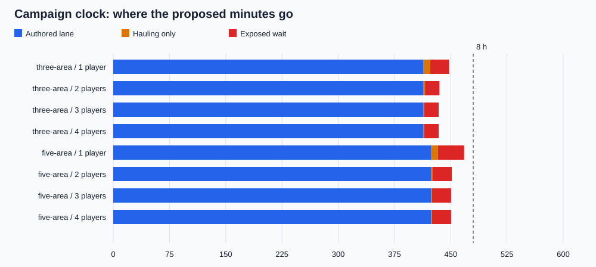
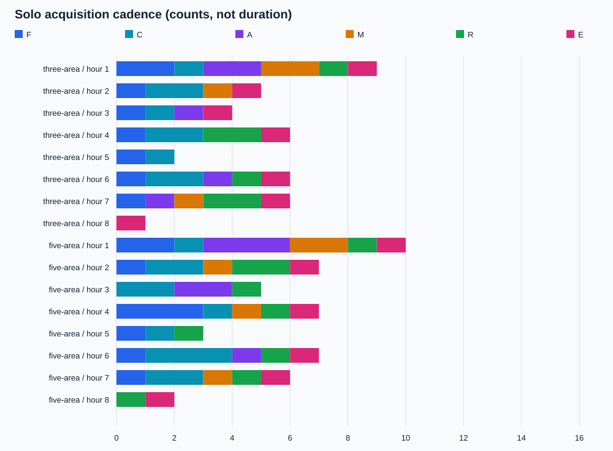
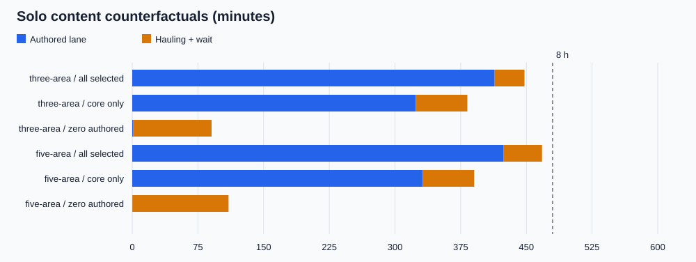

# Progression on paper: two candidate campaigns

> **Verdict:** Paper schedules for a three-area and a five-area route, neither selected.
> **Top recommendations:** 1. Neither route is selected. 2. Content is the dominant uncertainty. 3. Freight and late-game abilities need scrutiny.
> **Status:** reference.

_Note added 6 November 2026: the owner moved the main-game target to roughly six hours, a rough target rather than a rule, with solo and groups of two or three close together ([decision log](../decisions.md#the-shape-of-the-game)). Read eight-hour figures below as the earlier target._

_5 November 2026. Owner-authorized early tooling exception; no route selected, gameplay changed, push or ship. Generated numbers are deterministic design arithmetic, not measurements or playtest approval._

The full-shopping, curious solo forecasts are **7.46 h (three-area) and 7.80 h (five-area)**. They depend on **413.8 / 423.6 minutes of named but unbuilt authored activity**. Removing optional play or the authored durations shortens them; no bill was raised to hit eight hours. The model can expose missing content and bottlenecks; it cannot establish that these minutes are fun.

## Scope, authority and inputs

The [brief](../brainstorms/progression.md) remains proposed. [Upgrade economy](upgrade-economy.md#what-deveconomymodelts-needs-to-simulate), [next destinations](next-destinations.md#three-ways-to-fit-an-eight-hour-arc) and [rail economy](rail-economy-model.md) supply the comparison questions. This serves DESIGN’s **Toys before chores**, **Designed for drop-in, drop-out** and **Small and readable**. The exception authorizes this paper experiment ahead of the replay, not building either route. No Boogler copy was edited; no suspect dialogue was encountered in the tooling scope.

- **Three-area**: starter → Glasshouse/fibre → sail tower → Split Shell/cement → bell terraces → Exhibition/steel → optional observatory → original island. Double jump at the sail tower is this unresolved variant only. Crystal/copper are omitted, not smuggled in as extra areas.
- **Five-area**: starter → chalk/cement → steel harbour → suspended coast/crystal → port/copper → original island. Starter double jump, hook and glide remain. The four-resource catalogue retains C1–C6, S1–S6, X1–X4, U1–U6 and C5 → U6. Both routes explicitly experiment with further jumps, faster glide, longer hook and a plate-target hook **pull**, never swing.

All economic quantities, durations, geometry thresholds, capacities, reserves and attendance times are named inputs in [campaign-kit.ts](../../dev/economy/campaign-kit.ts), [three-area.ts](../../dev/economy/three-area.ts) or [five-area.ts](../../dev/economy/five-area.ts). Shared engine constants are structural identities/unit conversions, not hidden balance knobs. CLI overrides are recorded in JSON. Every output below uses the complete input snapshots in [results.json](progression-sim/results.json); this file also includes every unlock, first modeled use, remaining use window, hourly count, material ledger and counterfactual.

Input SHA-256: `508d84773eab6d8b69bd5b32107765b017e332a635f545bc3c9f86af140a9f76`. Engine/report source SHA-256: `5c01a75aed94c8ac2a661241a9eaba7afd9ffd54792ff0ba1eee618fde9b3c91`. Base checkout: `d990af89fa8d5ca45bde834a0992085252d2aa8a`; hashes identify the uncommitted simulation sources used at generation, not a claim that the base commit contains them. See [manifest](progression-sim/manifest.json).

## Model contract and deliberate limits

This is a discrete-event schedule, separate from the historical model fixtures. Each finite raw source processes 1 raw unit into 1 component, with explicit recipe input/output accounts; seed stock is charged once at initialization. There is no renewal, waste or hidden income. Sources stop at demand or per-material rack capacity. Bills reserve shipments once, mixed final loads respect carry capacity, and deposits become installed stock once. Raw, loose, processing, reserved/rail, carried, deposited and installed units remain accounted for at every event. Conservation and exactly-once installation are not tunables.

One shared authored activity lane prevents dividing the story by headcount; additional active workers haul while it runs. This is an explicit conservative scheduling assumption, not a co-op engagement model. All workers are fungible at job sites: per-job local carry distance is charged, but repositioning between distant work sites is not modeled. The reported human labour excludes automatic manufacturing and train travel. Costs never scale with party size. Acquisition counts have one primary kind; practice is not another A, and E is excluded from functional-novelty gaps.

The rail graph has stations, bidirectional lines, finite trains and loads, acceleration/deceleration, empty positioning/return trips, dwell, receiving capacity and transfers. Routing chooses stable fewest-hop paths, not a globally optimal timetable. Sources consolidate a load up to the bill, rack and wagon limits before dispatch; different lines/deliveries overlap. Reservations occupy receiving capacity before arrival. No passengers, overtaking, switches, backhaul optimization, train ownership choices, or missed-boardings are simulated. U5’s capacity effect is only a proxy for its proposed passenger/freight separation; S4/U3 open preset cross-links. Source-rate improvements are generic preparation multipliers, not a claim that an axe accelerates a real kiln.

Ability paths are authored alternatives with explicit minimum extra jumps, glide speed, hook reach/type or permanent route prerequisites. The fastest available alternative changes travel and puzzle time; abilities are not given a fictional universal seconds-per-upgrade value. This borrows the requirement-graph idea from [place-level.ts](../../dev/economy/place-level.ts), without importing its terrain or claiming physics reachability. The five-area route currently exercises its iterative movement chiefly on the final approach: that is a content weakness, visible in first-use/omission results.

Late visitors immediately inherit shared capabilities and personal reward eligibility, retaining unseen reveal opportunities without duplicating materials. A departing carrier retains their personal cargo; its project reservation is released, so another worker can fund the deficit from remaining finite supply. Retained cargo is not silently confiscated or automatically re-donated on return. Interrupted authored work can pass to the remaining player. When empty, only already-started production/deliveries and fully funded builds finish; no new purchase, extraction or freight dispatch starts. These are offline assumptions, not a production save/sync implementation. 5–6 players, finite-stock hoarding beyond the tested deficit, optional dismantling/refunds and persistent personal claim/replay execution remain future work.

## Baseline clocks and grind proxies

Minutes below are modeled, not wall-clock runtime. **Authored** includes named first approaches/puzzle paths. **Haul-only** is elapsed time hauling with no authored lane running; **wait** has neither lane active while someone is present. These three partition the baseline clock. **Haul labour** sums person-minutes including overlap; grind share is conservatively (haul-only + wait) / elapsed. A longer task is not necessarily grind and a named task is not proof of enjoyable content.

| Route / players | Finish min | Authored min | Haul-only min | Wait min | Haul labour min | Grind proxy | Loads / rail legs / transfers |
| --------------- | ---------- | ------------ | ------------- | -------- | --------------- | ----------- | ----------------------------- |
| three-area / 1  | 447.9      | 413.8        | 8.9           | 25.2     | 8.9             | 7.6%        | 63 / 48 / 23                  |
| three-area / 2  | 435.0      | 413.8        | 1.9           | 19.2     | 9.6             | 4.9%        | 76 / 48 / 23                  |
| three-area / 3  | 433.9      | 413.8        | 0.9           | 19.2     | 9.6             | 4.6%        | 76 / 48 / 23                  |
| three-area / 4  | 433.9      | 413.8        | 0.9           | 19.2     | 9.8             | 4.6%        | 77 / 48 / 23                  |
| five-area / 1   | 467.9      | 423.6        | 9.3           | 35.0     | 9.3             | 9.5%        | 75 / 54 / 16                  |
| five-area / 2   | 451.5      | 423.6        | 2.3           | 25.5     | 10.0            | 6.2%        | 89 / 54 / 16                  |
| five-area / 3   | 450.5      | 423.6        | 1.3           | 25.5     | 10.1            | 6.0%        | 89 / 54 / 16                  |
| five-area / 4   | 450.5      | 423.6        | 1.3           | 25.5     | 10.2            | 6.0%        | 90 / 54 / 16                  |



## Hour-by-hour upgrade mix

Each cell is **F/C/A/M/R/E acquisitions**, in that order. Zeros after completion are a finished campaign, not a demand for endless purchases. No hourly timer gates the route. A practice beat consumes authored time but adds no A. The full JSON retains each acquisition timestamp.

### Glasshouse → Split Shell → Exhibition, with small stops

| Hour | 1 player    | 2 players   | 3 players   | 4 players   |
| ---- | ----------- | ----------- | ----------- | ----------- |
| 1    | 2/1/2/2/1/1 | 2/1/2/2/1/1 | 2/1/2/2/1/1 | 2/1/2/2/1/1 |
| 2    | 1/2/0/1/0/1 | 2/2/0/1/0/2 | 2/2/0/1/0/2 | 2/2/0/1/0/2 |
| 3    | 1/1/1/0/0/1 | 0/1/1/0/1/0 | 0/1/1/0/1/0 | 0/1/1/0/1/0 |
| 4    | 1/2/0/0/2/1 | 1/3/0/0/1/1 | 1/3/0/0/1/1 | 1/3/0/0/1/1 |
| 5    | 1/1/0/0/0/0 | 1/1/1/0/1/0 | 1/1/1/0/1/0 | 1/1/1/0/1/0 |
| 6    | 1/2/1/0/1/1 | 2/1/0/1/1/1 | 2/1/0/1/1/1 | 2/1/0/1/1/1 |
| 7    | 1/0/1/1/2/1 | 0/0/1/0/1/1 | 0/0/1/0/1/1 | 0/0/1/0/1/1 |
| 8    | 0/0/0/0/0/1 | 0/0/0/0/0/1 | 0/0/0/0/0/1 | 0/0/0/0/0/1 |

### Chalk → steel → crystal → port → original island

| Hour | 1 player    | 2 players   | 3 players   | 4 players   |
| ---- | ----------- | ----------- | ----------- | ----------- |
| 1    | 2/1/3/2/1/1 | 2/1/3/2/1/1 | 2/1/3/2/1/1 | 2/1/3/2/1/1 |
| 2    | 1/2/0/1/2/1 | 1/3/1/1/2/1 | 1/3/1/1/2/1 | 1/3/1/1/2/1 |
| 3    | 0/2/2/0/1/0 | 0/2/1/0/1/1 | 0/2/1/0/1/1 | 0/2/1/0/1/1 |
| 4    | 3/1/0/1/1/1 | 4/0/0/1/1/0 | 4/0/0/1/1/0 | 4/0/0/1/1/0 |
| 5    | 1/1/0/0/1/0 | 0/2/0/0/2/1 | 0/2/0/0/2/1 | 0/2/0/0/2/1 |
| 6    | 1/3/1/0/1/1 | 1/2/1/0/0/0 | 1/2/1/0/0/0 | 1/2/1/0/0/0 |
| 7    | 1/2/0/1/1/1 | 1/2/0/1/1/1 | 1/2/0/1/1/1 | 1/2/0/1/1/1 |
| 8    | 0/0/0/0/1/1 | 0/0/0/0/1/1 | 0/0/0/0/1/1 | 0/0/0/0/1/1 |



## Time to every unlock

Minutes since arrival; “—” means not acquired/used before the ending. First use is the first scheduler read of an affected capability or path, not a noticed player benefit. A higher capacity can be read without saving a whole trip; omission tests below measure the net schedule consequence. All costs/dependencies remain in the route data.

### three-area

| Unlock / kind                                                    | 1p    | 2p    | 3p    | 4p    | Solo first modeled use | Solo minutes left |
| ---------------------------------------------------------------- | ----- | ----- | ----- | ----- | ---------------------- | ----------------- |
| path: Walkable first path (R)                                    | 12.1  | 10.3  | 9.7   | 9.7   | —                      | 435.8             |
| axe: Proper axe (F)                                              | 13.4  | 11.6  | 11.1  | 11.1  | 13.4                   | 434.4             |
| pack: Carry frame (F)                                            | 15.4  | 13.0  | 12.4  | 12.4  | 16.4                   | 432.5             |
| forge: Forge service (M)                                         | 17.2  | 14.3  | 13.7  | 13.7  | —                      | 430.7             |
| hook: Hook pull discovery (A)                                    | 22.2  | 19.3  | 18.7  | 18.7  | 43.6                   | 425.7             |
| rack: Nearby supplied rack (C)                                   | 24.6  | 20.6  | 20.1  | 20.1  | 31.6                   | 423.2             |
| glider: Glider discovery and first return (A)                    | 30.6  | 26.6  | 26.1  | 26.1  | —                      | 417.2             |
| network: First useful freight line (M)                           | 33.6  | 28.4  | 27.4  | 27.4  | —                      | 414.3             |
| starter-close: Pier outlook and village visit (E)                | 43.6  | 38.4  | 37.4  | 37.4  | —                      | 404.3             |
| F0: Loom source works (C)                                        | 67.2  | 61.9  | 60.8  | 60.8  | —                      | 380.7             |
| F1: Fibre loading straps (C)                                     | 69.1  | 63.7  | 62.7  | 62.7  | 92.1                   | 378.8             |
| F2: Fibre carrying sling (F)                                     | 138.5 | 75.8  | 74.8  | 74.8  | 150.2                  | 309.3             |
| F3: Glider cloth (F)                                             | 92.8  | 67.8  | 66.8  | 66.8  | 94.3                   | 355.1             |
| F4: First fibre resource hub (M)                                 | 94.3  | 70.5  | 69.5  | 69.5  | 95.1                   | 353.5             |
| F5: Town awnings (E)                                             | 150.6 | 114.8 | 113.8 | 113.8 | —                      | 297.2             |
| glass-side: Optional upper baskets and resident rooms (E)        | 92.1  | 86.7  | 85.7  | 85.7  | —                      | 355.8             |
| sail: Sail-testing tower and second jump device (A)              | 150.2 | 142.5 | 141.5 | 141.5 | 150.3                  | 297.7             |
| C0: Shell kiln source works (C)                                  | 178.2 | 170.5 | 169.5 | 169.4 | —                      | 269.6             |
| C1: Precast piers across the crack (R)                           | 183.6 | 175.9 | 174.9 | 174.8 | —                      | 264.2             |
| C2: Cement stock bays (F)                                        | 207.2 | 187.9 | 186.9 | 186.9 | 209.1                  | 240.6             |
| C3: Dry ramps (C)                                                | 207.1 | 185.3 | 184.3 | 184.2 | 208.1                  | 240.8             |
| C4: Frontier depot extension (C)                                 | 212.3 | 200.2 | 199.2 | 199.2 | 255.5                  | 235.6             |
| C5: Cutting bench (C)                                            | 255.8 | 227.7 | 226.7 | 226.7 | 302.5                  | 192.0             |
| C6: High landing ledges (R)                                      | 207.1 | 182.6 | 181.6 | 181.5 | 212.3                  | 240.7             |
| shell-side: Optional chambers inside the folded coast (E)        | 206.6 | 198.9 | 197.9 | 197.8 | —                      | 241.2             |
| jump-plus: Third jump device on the bell terrace (A)             | 301.5 | 289.4 | 288.4 | 288.4 | —                      | 146.3             |
| hook-long: Long hook reel on the bell terrace (F)                | 273.5 | 261.4 | 260.4 | 260.4 | —                      | 174.3             |
| S0: Exhibition foundry source works (C)                          | 302.9 | 290.7 | 289.7 | 289.7 | —                      | 145.0             |
| S2: Steel truss and engine exit (R)                              | 310.1 | 297.9 | 296.9 | 296.9 | —                      | 137.8             |
| S1: Cylinder and freight chassis (F)                             | 332.5 | 312.5 | 311.4 | 311.4 | 332.9                  | 115.4             |
| S3: Magazine feeder (C)                                          | 332.4 | 307.1 | 306.0 | 306.0 | 361.4                  | 115.4             |
| S5: Steel tool heads (F)                                         | 361.8 | 349.2 | 348.2 | 348.2 | 397.5                  | 86.0              |
| S6: Hook return and catwalk (R)                                  | 361.8 | 347.2 | 346.2 | 346.2 | —                      | 86.0              |
| S4: Roundhouse and junction assembly (M)                         | 365.0 | 352.5 | 351.5 | 351.5 | —                      | 82.8              |
| exhibit-side: Optional fair exhibits and workshop interiors (E)  | 332.1 | 319.9 | 318.9 | 318.9 | —                      | 115.8             |
| hook-type: Plate-target hook head at the observatory (A)         | 404.5 | 392.0 | 390.9 | 390.9 | —                      | 43.4              |
| observatory: Broken observatory: see the final island by day (E) | 417.5 | 405.0 | 403.9 | 403.9 | —                      | 30.4              |
| return: Final return connection from known kits (R)              | 417.9 | 393.3 | 392.3 | 392.3 | —                      | 30.0              |
| ending: Meet The Boogler; retain the revisitable ending (E)      | 447.9 | 435.0 | 433.9 | 433.9 | —                      | 0.0               |

### five-area

| Unlock / kind                                                   | 1p    | 2p    | 3p    | 4p    | Solo first modeled use | Solo minutes left |
| --------------------------------------------------------------- | ----- | ----- | ----- | ----- | ---------------------- | ----------------- |
| path: Walkable first path (R)                                   | 12.1  | 10.3  | 9.7   | 9.7   | —                      | 455.8             |
| axe: Proper axe (F)                                             | 13.4  | 11.6  | 11.1  | 11.1  | 13.4                   | 454.5             |
| jump: Second jump discovery (A)                                 | 17.1  | 15.3  | 14.7  | 14.7  | —                      | 450.8             |
| pack: Carry frame (F)                                           | 19.0  | 16.6  | 16.1  | 16.1  | 20.0                   | 448.8             |
| forge: Forge service (M)                                        | 20.9  | 18.0  | 17.4  | 17.4  | —                      | 447.0             |
| hook: Hook pull discovery (A)                                   | 25.9  | 23.0  | 22.4  | 22.4  | —                      | 442.0             |
| rack: Nearby supplied rack (C)                                  | 28.3  | 24.3  | 23.7  | 23.7  | 35.3                   | 439.6             |
| glider: Glider discovery and first return (A)                   | 34.3  | 30.3  | 29.7  | 29.7  | —                      | 433.6             |
| network: First useful freight line (M)                          | 37.3  | 32.1  | 31.1  | 31.1  | —                      | 430.6             |
| starter-close: Pier outlook and village visit (E)               | 47.3  | 42.1  | 41.1  | 41.1  | —                      | 420.6             |
| C0: Kiln source works (C)                                       | 66.7  | 61.4  | 60.4  | 60.4  | —                      | 401.1             |
| C1: Precast feet and outbound deck (R)                          | 68.7  | 63.3  | 62.3  | 62.3  | —                      | 399.2             |
| C2: Larger stock bays (F)                                       | 106.6 | 72.7  | 71.7  | 71.6  | 108.2                  | 361.3             |
| C3: Dry apron and loading ramps (C)                             | 90.2  | 70.0  | 69.0  | 69.0  | 106.2                  | 377.7             |
| C4: Satellite resource depot (M)                                | 110.0 | 104.1 | 103.1 | 103.1 | 158.0                  | 357.9             |
| C5: Workshop cutting bench (C)                                  | 158.4 | 115.5 | 114.5 | 114.5 | 159.1                  | 309.4             |
| C6: High landing ledges (R)                                     | 90.3  | 67.3  | 66.3  | 66.3  | —                      | 377.6             |
| sledge: Shelter breach device and cut (A)                       | 120.0 | 114.1 | 113.1 | 113.1 | —                      | 347.9             |
| chalk-side: Optional cliff interiors and shelter stories (E)    | 89.7  | 84.3  | 83.3  | 83.3  | —                      | 378.2             |
| S0: Steel source works (C)                                      | 161.2 | 155.3 | 154.3 | 154.3 | —                      | 306.7             |
| S2: Truss span kit (R)                                          | 166.6 | 160.7 | 159.7 | 159.7 | —                      | 301.3             |
| S3: Overhead loading crane (C)                                  | 186.0 | 167.1 | 166.1 | 166.1 | 207.0                  | 281.9             |
| S1: Cylinder and freight chassis (F)                            | 207.4 | 200.0 | 199.0 | 199.0 | 208.5                  | 260.5             |
| S5: Tool heads (F)                                              | 207.4 | 202.0 | 201.0 | 201.0 | 207.8                  | 260.4             |
| S6: Permanent hook return and catwalk (R)                       | 207.3 | 199.0 | 198.0 | 198.0 | —                      | 260.5             |
| S4: Roundhouse and junction assembly (M)                        | 213.0 | 204.8 | 203.8 | 203.8 | —                      | 254.9             |
| steel-side: Optional dry dock interiors and engine displays (E) | 185.6 | 179.7 | 178.7 | 178.7 | —                      | 282.3             |
| X0: Connected seed preparation (C)                              | 268.7 | 260.6 | 259.6 | 259.6 | —                      | 199.1             |
| X1: Collared downward support (R)                               | 270.9 | 262.7 | 261.7 | 261.7 | —                      | 197.0             |
| X2: Home work deck (C)                                          | 308.3 | 287.9 | 286.9 | 286.9 | 353.3                  | 159.6             |
| X3: Fixed crane collar (F)                                      | 353.7 | 319.0 | 318.0 | 318.0 | 355.4                  | 114.2             |
| X4: High return landing (R)                                     | 308.3 | 284.0 | 283.0 | 283.0 | —                      | 159.6             |
| observatory: Optional daytime lens room and horizon view (E)    | 307.9 | 299.7 | 298.7 | 298.7 | —                      | 160.0             |
| U0: Copper source works (C)                                     | 353.6 | 345.0 | 344.0 | 344.0 | —                      | 114.3             |
| U2: Powered rack feed (C)                                       | 358.4 | 349.8 | 348.8 | 348.8 | 394.4                  | 109.5             |
| U1: Motor and equipped corridor (F)                             | 399.6 | 379.7 | 378.7 | 378.7 | 400.5                  | 68.3              |
| U4: Workshop lift (R)                                           | 394.8 | 369.2 | 368.2 | 368.2 | —                      | 73.1              |
| U5: Two-bay transfer equipment (C)                              | 394.8 | 370.2 | 369.2 | 369.2 | 395.1                  | 73.0              |
| U6: Powered bulk-preparation attachment (C)                     | 394.9 | 372.2 | 371.2 | 371.2 | 395.0                  | 73.0              |
| U3: Spur control and service bay (M)                            | 404.2 | 374.3 | 373.3 | 373.3 | —                      | 63.6              |
| port-side: Optional upper workshop and waterfront rooms (E)     | 394.4 | 387.8 | 386.8 | 386.8 | —                      | 73.5              |
| jump-plus: Third jump device (A)                                | 140.0 | 134.1 | 133.1 | 133.1 | —                      | 327.9             |
| glide-plus: Faster glider fitting (F)                           | 230.0 | 221.8 | 220.8 | 220.8 | —                      | 237.9             |
| hook-long: Long hook reel (F)                                   | 247.0 | 238.8 | 237.8 | 237.8 | 418.2                  | 220.9             |
| hook-type: Plate-target hook head (still a pull) (A)            | 352.3 | 343.7 | 342.7 | 342.7 | 418.2                  | 115.6             |
| return: Final return connection (R)                             | 437.9 | 421.5 | 420.5 | 420.5 | —                      | 30.0              |
| ending: Meet The Boogler; retain the revisitable ending (E)     | 467.9 | 451.5 | 450.5 | 450.5 | —                      | 0.0               |

## Waiting, nothing eligible to want, and functional gaps

“No desire” is a narrow, inspectable proxy: an idle active worker while there is no dependency-ready, uncompleted acquisition in the selected catalogue. It cannot infer motivation. A worker watching their friend’s authored activity may be happily involved. It excludes post-ending time, optional toys and locked future purchases. A separate functional gap counts time between non-E acquisitions; long puzzles can legitimately occupy it. The JSON preserves all windows; this table shows the three longest per run and total person-minutes.

| Route / players | Idle person-min | No-desire person-min | Three longest no-desire windows (min; idle people) | Longest functional gap min |
| --------------- | --------------- | -------------------- | -------------------------------------------------- | -------------------------- |
| three-area / 1  | 25.2            | 0.0                  | none                                               | 44.2                       |
| three-area / 2  | 446.5           | 122.7                | 142.5–167.8 (1); 38.4–60.5 (1); 405.0–425.0 (1)    | 66.7                       |
| three-area / 3  | 878.4           | 245.4                | 141.5–166.7 (2); 37.4–59.5 (2); 403.9–423.9 (2)    | 66.7                       |
| three-area / 4  | 1312.2          | 368.0                | 141.5–166.7 (3); 37.4–59.5 (3); 403.9–423.9 (3)    | 66.7                       |
| five-area / 1   | 35.0            | 0.0                  | none                                               | 43.9                       |
| five-area / 2   | 469.3           | 127.6                | 387.8–417.5 (1); 421.5–441.5 (1); 42.1–60.1 (1)    | 41.8                       |
| five-area / 3   | 917.7           | 255.3                | 386.8–416.5 (2); 420.5–440.5 (2); 41.1–59.1 (2)    | 41.8                       |
| five-area / 4   | 1367.9          | 382.9                | 386.8–416.4 (3); 420.5–440.5 (3); 133.1–151.1 (3)  | 41.8                       |

No E reward is used to hide an A/M or functional gap. In the solo data, review the interval ending at each entry below; it is a prompt to inspect the named activity, not an instruction to add another ability.

| Route      | Functional gap intervals (minutes → next unlock)                                                                                                                                                                                                                                                             |
| ---------- | ------------------------------------------------------------------------------------------------------------------------------------------------------------------------------------------------------------------------------------------------------------------------------------------------------------ |
| three-area | 33.6–67.2 → F0; 69.1–92.8 → F3; 94.3–138.5 → F2; 150.2–178.2 → C0; 183.6–207.1 → C3; 212.3–255.8 → C5; 255.8–273.5 → hook-long; 273.5–301.5 → jump-plus; 310.1–332.4 → S3; 332.5–361.8 → S6; 365.0–404.5 → hook-type; 417.9–447.9 → ending                                                                   |
| five-area  | 37.3–66.7 → C0; 68.7–90.2 → C3; 90.3–106.6 → C2; 120.0–140.0 → jump-plus; 140.0–158.4 → C5; 166.6–186.0 → S3; 186.0–207.3 → S6; 213.0–230.0 → glide-plus; 230.0–247.0 → hook-long; 247.0–268.7 → X0; 270.9–308.3 → X2; 308.3–352.3 → hook-type; 358.4–394.8 → U4; 404.2–437.9 → return; 437.9–467.9 → ending |

## Content debt, prices and purchase order

The core-only run has zero optional activities/purchases and retains all required travel/puzzles. Zero-authored removes all declared authored/puzzle durations but keeps actual modeled path distance, production, freight, carry and construction. It is an economy stress run, not a speedrun forecast. Differences therefore include newly exposed supply waits. Cost/rate/distance sweeps are assumptions, not confidence intervals. “blocked” means the 12 h ceiling was reached without the ending, never fabricated extra income.

| Route      | Change                         | Finish min, 1 / 2 / 3 / 4 players |
| ---------- | ------------------------------ | --------------------------------- |
| three-area | core only / zero optional play | 382.6 / 377.3 / 376.3 / 376.3     |
| three-area | zero authored duration         | 90.6 / 88.0 / 87.8 / 87.5         |
| three-area | 75% authored duration          | 346.7 / 334.0 / 333.0 / 332.7     |
| three-area | cost 75%                       | 447.1 / 433.9 / 433.2 / 433.2     |
| three-area | cost 125%                      | 451.0 / 436.4 / 434.9 / 434.5     |
| three-area | supply 0.5x                    | 452.5 / 437.6 / 436.8 / 437.3     |
| three-area | supply 2x                      | 445.7 / 433.8 / 432.8 / 432.9     |
| three-area | distance 0.75x                 | 441.6 / 430.6 / 429.8 / 429.8     |
| three-area | distance 1.5x                  | 460.3 / 444.0 / 442.6 / 442.2     |
| three-area | tool-first                     | 456.3 / 441.0 / 440.0 / 440.0     |
| three-area | cart-first                     | 456.2 / 440.7 / 439.7 / 439.7     |
| three-area | town-first                     | 448.9 / 442.0 / 441.0 / 440.9     |
| three-area | optional-first                 | 458.5 / 448.1 / 447.0 / 447.0     |
| five-area  | core only / zero optional play | 390.4 / 385.0 / 384.0 / 384.0     |
| five-area  | zero authored duration         | 110.0 / 107.4 / 107.1 / 106.8     |
| five-area  | 75% authored duration          | 364.8 / 348.8 / 347.8 / 347.5     |
| five-area  | cost 75%                       | 465.0 / 449.4 / 448.7 / 448.8     |
| five-area  | cost 125%                      | 475.3 / 455.7 / 454.3 / 453.9     |
| five-area  | supply 0.5x                    | 477.0 / 460.5 / 459.7 / 460.1     |
| five-area  | supply 2x                      | 464.5 / 448.2 / 447.2 / 447.3     |
| five-area  | distance 0.75x                 | 460.6 / 446.7 / 445.9 / 446.0     |
| five-area  | distance 1.5x                  | 483.0 / 461.9 / 460.5 / 460.1     |
| five-area  | tool-first                     | 468.4 / 454.8 / 453.8 / 453.8     |
| five-area  | cart-first                     | 466.7 / 454.5 / 453.5 / 453.5     |
| five-area  | town-first                     | 470.8 / 456.3 / 455.3 / 455.3     |
| five-area  | optional-first                 | 472.1 / 462.5 / 461.5 / 461.5     |



Eight hours is supported only if the named encounters earn their proposed durations. The direct route is shorter than the curious run; optional interiors and courses cannot be required to make the promise true. The cost +25% row adds labour and waiting, not authored play. Do not use that extra time to close a content deficit. The research’s 60/90/90/90/75/75 minute allowances were not copied as mandatory clock gates.

### Omit each optional functional purchase (solo)

Positive net saving means buying the option shortened the full route; negative means it cost more elapsed time than it saved. This includes its authored acquisition time and changed scheduling, so it is opportunity cost, not isolated mechanical payback. Optional descendants are omitted too (C5 → U6). Reward-only E options are outside this economic test. A path-opening upgrade may be worthwhile despite negative time savings; the player must judge that.

| Route / option         | Net minutes saved by buying | Haul labour minutes saved | First modeled use min | Minutes available before ending |
| ---------------------- | --------------------------- | ------------------------- | --------------------- | ------------------------------- |
| three-area / F2        | -1.22                       | -0.22                     | 150.2                 | 309.3                           |
| three-area / F3        | 2.24                        | -0.13                     | 94.3                  | 355.1                           |
| three-area / C2        | -1.00                       | -0.09                     | 209.1                 | 240.6                           |
| three-area / C5        | -1.00                       | 0.04                      | 302.5                 | 192.0                           |
| three-area / C6        | 2.24                        | -0.09                     | 212.3                 | 240.7                           |
| three-area / jump-plus | -3.96                       | 0.04                      | —                     | 146.3                           |
| three-area / hook-long | -1.96                       | 0.04                      | —                     | 174.3                           |
| three-area / S1        | -0.37                       | -0.04                     | 332.9                 | 115.4                           |
| three-area / S5        | 0.00                        | -0.04                     | 397.5                 | 86.0                            |
| three-area / S6        | 0.00                        | -0.04                     | —                     | 86.0                            |
| three-area / hook-type | -7.00                       | 0.00                      | —                     | 43.4                            |
| five-area / C2         | 1.00                        | -0.20                     | 108.2                 | 361.3                           |
| five-area / C5         | -5.22                       | 0.24                      | 159.1                 | 309.4                           |
| five-area / C6         | -1.00                       | -0.23                     | —                     | 377.6                           |
| five-area / S1         | -3.22                       | -0.05                     | 208.5                 | 260.5                           |
| five-area / S5         | -2.66                       | -0.05                     | 207.8                 | 260.4                           |
| five-area / S6         | -3.22                       | -0.05                     | —                     | 260.5                           |
| five-area / X3         | 0.66                        | 0.00                      | 355.4                 | 114.2                           |
| five-area / X4         | -1.00                       | -0.05                     | —                     | 159.6                           |
| five-area / U1         | -3.74                       | -0.07                     | 400.5                 | 68.3                            |
| five-area / U4         | -5.18                       | -0.07                     | —                     | 73.1                            |
| five-area / U5         | -5.18                       | -0.07                     | 395.1                 | 73.0                            |
| five-area / U6         | -4.40                       | -0.07                     | 395.0                 | 73.0                            |
| five-area / jump-plus  | -4.91                       | -0.00                     | —                     | 327.9                           |
| five-area / glide-plus | -5.00                       | 0.00                      | —                     | 237.9                           |
| five-area / hook-long  | -4.15                       | 0.00                      | 418.2                 | 220.9                           |
| five-area / hook-type  | -2.49                       | 0.04                      | 418.2                 | 115.6                           |

## Attendance, late visitors and failure cases

| Route / schedule     | Finish min | Absent min | Eligible / unseen reveals for late or p2 | Retained personal cargo                           |
| -------------------- | ---------- | ---------- | ---------------------------------------- | ------------------------------------------------- |
| three-area / late-3h | 442.7      | 0.0        | 39 / 18                                  | [{"id":"p1","cargo":{}},{"id":"late","cargo":{}}] |
| three-area / late-7h | 447.9      | 0.0        | 39 / 38                                  | [{"id":"p1","cargo":{}},{"id":"late","cargo":{}}] |
| three-area / 1-2-1   | 445.3      | 0.0        | 39 / 33                                  | [{"id":"p1","cargo":{}},{"id":"p2","cargo":{}}]   |
| three-area / absence | 507.9      | 60.0       | —                                        | [{"id":"p1","cargo":{}}]                          |
| five-area / late-3h  | 457.3      | 0.0        | 47 / 22                                  | [{"id":"p1","cargo":{}},{"id":"late","cargo":{}}] |
| five-area / late-7h  | 467.9      | 0.0        | 47 / 45                                  | [{"id":"p1","cargo":{}},{"id":"late","cargo":{}}] |
| five-area / 1-2-1    | 467.2      | 0.0        | 47 / 39                                  | [{"id":"p1","cargo":{}},{"id":"p2","cargo":{}}]   |
| five-area / absence  | 527.9      | 60.0       | —                                        | [{"id":"p1","cargo":{}}]                          |

| Route      | Removed freight edge | Outcome                           | Last completed unlock |
| ---------- | -------------------- | --------------------------------- | --------------------- |
| three-area | glass-line           | blocked, conserved stock retained | F0                    |
| five-area  | chalk-line           | blocked, conserved stock retained | C0                    |

The 1→2→1 schedule joins at hour 1 and leaves at hour 2 permanently. Absence is hour 2–3. Late joins are hours 3 and 7. Unit fixtures additionally depart during a full load, leave during funded construction, join after the ending, and exhaust raw supply: the last case must block without creating material. Baseline peak concurrent delivery counts: three-area/1p=3, three-area/2p=3, three-area/3p=3, three-area/4p=3, five-area/1p=4, five-area/2p=4, five-area/3p=4, five-area/4p=4.

## Conclusions and the next bounded proof

1. **Neither route is selected.** Both can close under fixed bills in this paper schedule, including solo, core-only and optional-first. The three-area route buys distinct named settings with fewer material chains; the five-area route has a more explicit bill catalogue. The arithmetic does not decide which is worth authoring.
2. **Content is the dominant uncertainty.** First time in an area, understanding a puzzle, watching construction, choosing an export and enjoying the return are all guessed. Replace one complete area’s timing with a fresh player’s trace before promising eight hours; accept a shorter result. Added costs do not create authored activity.
3. **Freight and late-game abilities need scrutiny.** Review batching, deadhead/transfer waits, the no-desire windows and options with no first use. Author an early use for an iterative move only if it creates an interesting route; otherwise omit it. Do not broaden this task into gameplay or retune the replay.

Unmeasured: actual fun, novice discovery, co-op role choice, movement geometry, local-fit benefits within 2–5 minutes, production/animation durations, service rates, reserves, physical layout and all device behavior. The paper duration is independent of machine load; no frame or wall-clock benchmark is used. A quiet-machine rerun is needed only for future runtime/feel/performance evidence, not to trust deterministic item counts. The owner replay and production-core gates remain separate.

## Reproduce and verify

```sh
npm run economy
npm run economy -- three-area --players=2 --policy=cart-first
npm run economy -- five-area --core-only --json
npm run economy -- five-area --scenario=late-7h --json
npm run economy -- three-area --content=0 --json
npm run economy -- five-area --omit=C5 --json
npm run economy -- --report
node --test test/economy.test.ts
node dev/economy/model.ts prototype
npm run check
```

The historical 437-second fit is retained as a regression, not current-game validation. New tests are the owner’s explicit conservation exception to the test diet. No game/runtime imports were added; no high-risk source folder was changed, so no nested source AGENTS or lockstep/sync math route is triggered. The tooling route explicitly calls for no browser. No bot or device run is claimed. `npm run inflight` was skipped because it fetches from GitHub, prohibited by the brief; only cached refs were inspected. No new dependency or network request was needed. Figures are SVG artifacts, not game screenshots. Not tested on a device.
