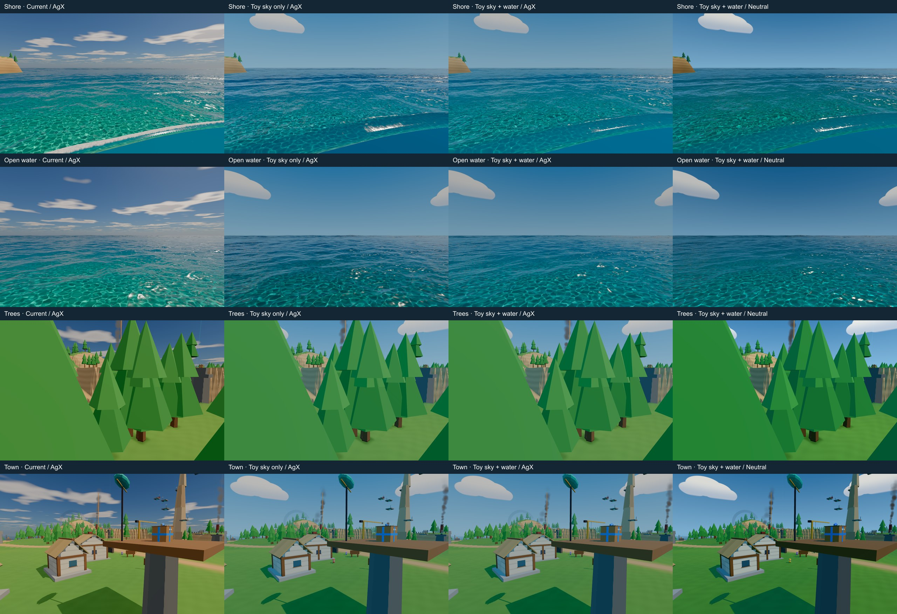
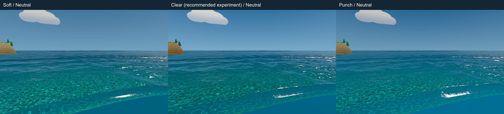

# Sunshine sky: keep the sea, author the sky

> **Verdict:** Keep the sea, author the sky; replaced by the summer sky default.
> **Top recommendations:** 1. Keep the shared baked cube and FFT sea; review the clear toy sky with metered Neutral.
> **Status:** superseded by [skybox](skybox.md).

3 November 2026. Bounded look experiment, not a production switch. DESIGN: **Show, don't tell; Small and readable**.

**Recommendation: keep the shared baked cube and FFT sea; review the `clear` toy sky with metered Neutral.** A skybox is a useful art source, but changing the container alone will not produce **Super Mario Sunshine**. The useful change is simpler clouds, deliberate sky colour and a restrained water palette. Metered Neutral is the leading curve candidate per the newer colour-source research; the broader three-look comparison is still coming. AgX Punchy belongs to the other job.

Play: `?proto=place&water=new&sky=toy&toyTone=neutral`. Add `&toyVariant=soft` or `&toyVariant=punch` for the other optical variants. Omit `toyTone` for production AgX; add `toyWater=off` for sky-only AgX. No `tune=1` or saved overrides in the board.



**Visual verdict:** the water is still beautiful: turquoise caustic shelves, fine waves and isolated white sparkle survive. Neutral gives the clouds/glints more life than AgX. The sky is cleaner, but the shared blue fill makes town walls/stone too cool and foliage more emerald; production has warmer solids. **Clear/Neutral is the best experiment, not an overall production win yet.** A hybrid retaining physical lighting is worth considering if that warm/cool shift is unwanted. The flat near-water wedge visible in both routes still reads artificial; grading does not fix it.



[Soft](../../.look/evidence/1793777271642-3580/evidence.json) is gentler;
[Punch](../../.look/evidence/1793777271842-3581/evidence.json) adds scatter and caps reflection harder without a convincing improvement. Differences are modest; retain Clear's less restricted sheen. All three were captured again after the final sky correction.

The owner-liked crossing-beauty **shot 2**, opened from the main checkout, remains the better target: warm timber, blue water, sparse white sparkle and uncluttered sky. We have not matched its composition, faceted clouds or stronger sun path. [Board provenance](sunshine-sky/comparison.json): same camera per row, 960×600, 20-second warm-up, adaptive exposure with **no curve trim**. Wave/NPC phases vary. Screenshots are only resized and labelled.

## Procedural versus painted, for this renderer

Confirmed in `frozen-sky.ts` and `sky.ts`: `water=new` bakes the late-morning atmosphere **once during loading** into a 1024²-per-face RGBA16F cube. Background, water sky reflection, directional fog, environment and coarse hemisphere fill read it; caves retain their own transition. Tuning can deliberately rebake. **Sun direction/colour are separate:** the background adds its disc/halo through cube cloud alpha; water adds its GGX sun/glitter lobe. No planar scene reflection exists.

So a painted sky mostly swaps the cube's contents. Still author/derive **sun direction and colour, HDR brightness, fill, fog colour, cloud alpha and reflection tint/contrast/mips**. Avoid a duplicate painted sun. This experiment keeps the physical sun and derives fog/fill from the authored cube; blue sky uses sun brightness, not warm sun RGB.

| Source | What it buys / what it costs |
| --- | --- |
| Painted equirectangular image or six faces | Best direct composition control. A 2:1 image needs a seamless longitude join and pole treatment; six faces need matching edges and filtered mips. LDR art requires explicit HDR calibration and a separate cloud mask. A 2K painted download might be hundreds of KB to a few MB, content/codec dependent, not measured here. Avoid heavy JPEG ringing and gradient banding; prefer a high-bit-depth working master. |
| Stylized procedural gradient + authored cumulus | Recommended first. Original direction-space shapes have no equirectangular seam, no image download, and cheap agent iteration. Only six loading-time draws use their extra arithmetic; ordinary play retains the same samples and resources. The current shapes are simple, not final cloud art. |
| Physical lighting + stylized visible background | Useful if the accepted light must stay fixed. Requires separate lighting/background sources and an explicit choice for fog and water reflection. Physical wisps reflected under cartoon clouds can look disconnected. A second cube adds memory; a background texture can avoid that full duplication. More art calibration for us than one coherent cube. |

No option automatically saves per-frame sky work: it is already cached. The existing cube is **64 MiB including mips**, before PMREM/LUT overhead; this experiment retains it and the physical-atmosphere calculation. Half-float protects working gradients, but SDR output can still band. No dither, isolated GPU timing or download measurement added.

`npm run concepts` can paint original candidates from our captures and a 2:1 brief, but **does not guarantee seamless equirectangular output**. Its generic size/tileability prompts need longitude/pole, projection, HDR, alpha and mip-seam inspection; Codex may choose a nearby size. No image generation or external art used here.

## What to take from Super Mario Sunshine

[sunshine-look.md](sunshine-look.md) supports the visual target: saturated cyan-to-turquoise water, strong sparse white sparkle, warm sand/stone, hard bright sun, simple cloud masses, a bright horizon and strong value separation. Those suit our faceted toy world. Preserve readable cool shade rather than black foliage faces. Heat haze and sun-local glow reinforce heat **after** the palette works. Existing analytic sun halo remains; bloom/heat haze are not added by this flag. Sunshine's documented lens-glow evidence is not proof of modern HDR bloom.

Its tiny scrolling wave textures, deliberately authored mip brightness and TEV/framebuffer tricks are hardware-era ways to create those sensations, not requirements to reproduce low resolution, banding or limited geometry. Keep our FFT waves, shore, caustics, foam and sky reflections. This pass tunes absorption/scatter, water-body saturation, sun gain, glitter, foam brightness, and reflection tint/cap; no wave, shore, caustic or gameplay numbers change. The lower reflection cap is restrained so the sea retains an angle-dependent sheen.

Read both colour reports at the brief's fallback paths, plus `surface.ts`, `post.ts`, `tone.ts` and the Look decisions. Sources were read locally; no external fetch. The newer report changes the hypothesis ranking, not production authority.

## Copy settings

The query selects the authored sky and Neutral. Append `&tune=1` and use the existing panel's Apply settings for this **clear** water preset (linear RGB; absorption in inverse metres). The JSON cannot select a sky or tone curve. Bloom stays off for this comparison.

```json
{
  "version": 1,
  "changes": {
    "water.absorption": [0.55, 0.055, 0.035],
    "water.scatter": [0, 0.075, 0.115],
    "water.saturation": 1.08,
    "water.reflectGain": 0.92,
    "water.reflectCap": 0.8,
    "water.reflectTint": [0.86, 1, 1],
    "water.sunGain": 1.08,
    "water.glitter": 0.72,
    "water.foamTint": [0.78, 0.86, 0.88],
    "water.foamBright": 0.8,
    "post.exposure": 1,
    "post.autoExposure": 1,
    "post.keyValue": 0.18,
    "post.contrast": 1,
    "post.saturation": 1,
    "post.bloom": 0
  }
}
```

## Checks and limits

- `npm run check`: passed, 292 unit tests, lint/typecheck, registries, levels, assets and build. Code is confined to `src/render/water`; `src/debug/water-tuning.ts` and `tone.ts` untouched. Off-flag branches retain the same shader arithmetic/constants; no deterministic pixel-hash test was performed.
- [Full place bot](../../.look/evidence/1793776648510-67883/evidence.json): every expected solo beat completed, zero graphics errors; report and end still opened. Co-op was not marked in the solo run. The initial attempt omitted `shot=play`, never started the bot and stalled; corrected above.
- [Trusted scenarios](../../.look/evidence/1793776744239-70918/evidence.json): world-inputs passed. Smoke's final common-tick hash assertion failed because this build lacks the newer harness's bounded hash capture; joining, toss, ball movement and ongoing hash checks passed, zero graphics errors. No networking changes made to accommodate a harness mismatch.
- [Motion](../../.look/evidence/1793777039461-80486/evidence.json): opened sheet, curves and three consecutive frames extracted from its real-time video. Fine wave/caustic patterns and isolated glints change between frames; no frozen sheet. This does not establish real-time feel/smoothness or sparkle aliasing during camera motion. Not tested on a device; no isolated GPU timing.
- The first Neutral captures emitted a TSL RGBA/RGB shape error; fixed before the final tree. All **16 final board captures**, both alternative variants and the motion capture passed WebGPU/frame/error checks on code commit `ae3b2c65`; the board and variant strip were opened. No source changed during runs. Owner review, not graduation, is next.
